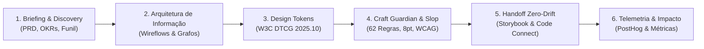

# Open UX Harness

> **Agentic Infrastructure & Harness de Alta Performance para Product Designers e Engenharia de Interface**  
> *Agnóstico a modelos de IA | Agnóstico a plataformas de desenvolvimento | 100% Open Source (MIT)*

[-blueviolet.svg)](https://github.com/Phillnascimento/open-ux-harness)
[](https://opensource.org/licenses/MIT)
[](https://design-tokens.github.io/community-group/format/)
[](https://www.w3.org/TR/WCAG22/)
[](https://modelcontextprotocol.io/)
[-success.svg)](https://github.com/Phillnascimento/open-ux-harness)

> [!NOTE]
> **Versão 0.1.0 (Alpha):** Este projeto encontra-se em estágio inicial de desenvolvimento ativo (fase Alfa). As interfaces de contratos, os esquemas de skills e os compiladores de adaptadores estão sujeitos a refinamentos contínuos com base nos testes práticos da comunidade.

---

## Por que o Open UX Harness existe

A utilização ingênua de Modelos de Linguagem (LLMs) em Product Design e Desenvolvimento de UI gera dois problemas crônicos documentados pela indústria:

1. **O "Scaffold Effect" (Desperdício de até 40x em Tokens):**  
   Carregar dezenas de ferramentas MCP brutas e transcrições extensas na janela de contexto de um modelo encarece a inferência em até 40 vezes e causa degradação de atenção (*lost-in-the-middle*). Modelos avançados operando em invólucros arquiteturais frágeis perdem em precisão para modelos intermediários contidos em um **harness otimizado**.
2. **"Visual Slop" e Desconexão Técnica:**  
   Modelos sem restrições heurísticas alucinam margens arbitrárias (como 13px ou 21px), violam taxas de contraste de acessibilidade (WCAG 2.2), geram gradientes clichês de IA (paletas genéricas com halos luminosos), ignoram design systems homologados e produzem componentes duplicados em vez de reutilizar código existente.

O **Open UX Harness** é a infraestrutura de engenharia criada para solucionar esses desafios: um ecossistema modular com governança determinística que atua como co-piloto técnico e estratégico, cobrindo todo o ciclo de vida do design — **do briefing à telemetria de impacto pós-deploy**.

---

## Pilares Fundamentais

* **Totalmente Agnóstico a Motores de IA:**  
  A inteligência atua como um recurso intercambiável (*AI as a commodity*). O harness abstrai chamadas, tokens e ferramentas, operando de forma transparente com qualquer motor moderno (seja proprietário via API comercial ou pesos abertos executados localmente).
* **Agnóstico a Plataformas de Desenvolvimento:**  
  Compila nativamente para Google Antigravity, Claude Code CLI, Cursor, Windsurf, Roo Code, Cline e Terminal puro (Codex).
* **Versatilidade Operacional (Do Freelance à Grande Empresa):**
  * **Modo Freelance / Lean:** Sem dependência de infraestrutura pesada. Tokens em JSON estruturado, protótipos em HTML/Tailwind/React e auditoria local em menos de 5 minutos.
  * **Modo Enterprise / Scale:** Conexão com Figma Console MCP (Desktop Bridge WebSocket), conformidade W3C DTCG 2025.10, Storybook MCP com regressão visual Playwright, e telemetria pós-deploy PostHog.
* **Skill-Driven Context Engine (Dynamic Pruning):**  
  As Skills governam os servidores MCP, ativando apenas as ferramentas estritamente necessárias para a tarefa ativa, reduzindo em mais de 70% o inchaço de contexto (*token bloat*).
* **Auditoria Determinística Anti-Slop (Padrão Impeccable):**  
  Motor com 62 regras determinísticas que barram padrões amadores de IA antes de qualquer aprovação em código ou design.

---

## Matriz de Arquétipos Cognitivos & Capacidades de IA

Em vez de se acoplar a nomes comerciais ou versões passageiras de modelos, o Open UX Harness divide a orquestração em **arquétipos funcionais baseados em capacidades arquiteturais**:

| Papel no Harness | Perfil Cognitivo Requerido | Responsabilidades no Fluxo | Classe Arquitetural de IA |
| :--- | :--- | :--- | :--- |
| **Crítica Cognitiva & Heurística (Subagente A)** | Raciocínio analítico profundo, planejamento passo a passo e empatia com modelos mentais do usuário. | Avaliação de atrito de usabilidade, clareza na proposta de valor, hierarquia visual e coerência da arquitetura de informação. | **Modelos com Raciocínio Estendido / Cadeia de Pensamento:** Modelos capazes de auditar internamente premissas e avaliar trade-offs ergonômicos antes de gerar respostas. |
| **Auditoria Determinística & Linter (Subagente B)** | Baixa latência, execução veloz de chamadas estruturadas (*tool use*) e rigor sintático. | Varredura de código contra as 62 regras anti-slop, cálculo de taxas de contraste WCAG, e validação de tokens contra o grid de 8px. | **Modelos Rápidos de Ferramentas / Alta Eficiência:** Motores focados em velocidade, alto throughput e inspeção precisa de AST/regex sem sobrecarga computacional desnecessária. |
| **Engenharia de Interface & Handoff** | Precisão estrita em TypeScript/CSS/HTML semântico e capacidade de reutilização modular. | Geração de componentes limpos, montagem de variações de estado (default, empty, loading, error) e alinhamento com bibliotecas homologadas. | **Modelos Especializados em Código:** Motores com alto desempenho em síntese de software, refatoração e respeito a contratos formais de tipos. |
| **Inspeção Visual Multimodal** | Alta resolução perceptual em análise de imagens e comparação visual comparativa. | Validação visual contra pranchetas do Figma, detecção de desvios visuais (*visual drift*) e auditoria de capturas de tela Playwright. | **Modelos Multimodais Nativos de Alta Fidelidade:** Motores capazes de correlacionar coordenadas espaciais de layouts com capturas reais de navegadores. |
| **Operação Local & Soberania de Dados** | Execução totalmente desconectada da nuvem para segurança corporativa estrita. | Processamento de código proprietário, design systems confidenciais e conformidade com políticas rígidas de privacidade. | **Modelos Abertos Locais (Local Inference):** Qualquer modelo open-weights executado via provedores locais compatíveis com API padrão, garantindo zero telemetria externa. |

---

## Ciclo de Vida UX End-to-End

O harness estrutura o trabalho em fases coordenadas, alimentando contratos de dados imutáveis entre cada etapa:



| Fase | Entregável de Design | Modo Freelance | Modo Enterprise |
| :--- | :--- | :--- | :--- |
| **1. Discovery** | Problem Framing, Personas e KPIs | Briefing guiado no terminal ou Markdown | Ingestão de PRD via Notion/Jira MCP |
| **2. Arquitetura** | Wireflows conceituais e taxonomia | Diagramas Mermaid renderizáveis | Mapeamento estrutural de dependências |
| **3. Tokens** | Contrato de dados de design | `tokens.json` simples + Tailwind config | W3C DTCG 2025.10 com linter integrado |
| **4. Figma** | Telas e Auto Layout | REST API oficial (leitura rápida) | Figma Console MCP (escrita em lote WebSocket) |
| **5. Craft Guardian** | Blindagem visual e acessibilidade | Linter heurístico 8pt + WCAG 2.2 AA | Scanner axe-core + contraste APCA + Slop Engine |
| **6. Handoff** | Código com paridade total | Snippets prontos React/Tailwind/HTML | Storybook MCP + Playwright diff visual |
| **7. Pós-Deploy** | Medição de impacto e conversão | Feedback qualitativo ou logs CSV | Anomalias de funil via PostHog MCP |

---

## Motores Arquiteturais do Core

### 1. AntiSlopEngine (62 Regras Determinísticas)
Inspirado nas heurísticas do projeto **Impeccable**, o motor analisa o código e o design em busca de defeitos típicos de geração sintética:
* **Bans Absolutos de Slop:** Rejeição de `side-tab` (bordas laterais espessas em cards redondos), `gradient-text` (degradê recortado em títulos), `ai-color-palette` (paletas roxo/azul genéricas com halos luminosos), `dark-glow` (sombras cromáticas com zero-offset), `nested-cards` (cards aninhados dentro de cards) e `kicker-above-heading` (micro-rótulos em caixa alta acima de todo heading).
* **Integridade Estrutural & Qualidade:** Detecção de `broken-image`, `cramped-padding` (<8px dentro de contornos com borda/fundo), `line-length` (>80ch sem quebra), `body-text-viewport-edge` (<16px das bordas da tela), `tight-leading` (<1.3x) e `tiny-text` (<12px).
* **Execução Híbrida:** Avaliação local via expressões regulares/AST com fallback transparente para a CLI `impeccable` caso esteja instalada.

### 2. Modos de Superfície (Surface Modes)
Calibram a ambição estética, densidade de dados e restrições tipográficas conforme o objetivo da interface:
* `Persuade` (Landing pages, conversão): Alta expressividade, imagens autênticas, tipografia editorial marcante.
* `Operate` (Dashboards, ferramentas SaaS): Alta densidade, numerais tabulares (`tabular-nums`), escaneabilidade rápida e moderação de elementos decorativos.
* `Read` (Documentação, artigos): Ritmo de leitura refinado, entrelinha confortável e largura controlada entre 65ch e 75ch.
* `Experience` (Portfólios, showcases): Interface recuada e neutra, dando protagonismo absoluto à obra ou ao produto.

### 3. Suporte Bidirecional a DESIGN.md
Compatibilidade nativa com o padrão aberto `DESIGN.md` (Google Labs standard):
* Cabeçalho frontmatter YAML estruturado com tokens de cores, tipografia, elevação e espaçamento.
* 8 seções canônicas de especificação: Role & Surface Mode, Brand & Personality, Color System, Typography, Spatial & Elevation, Component Styling, Interactions & Motion e Anti-Slop Constraints.
* Serialização e desserialização bidirecional entre o `DesignContract` TypeScript e arquivos Markdown.

### 4. Playbooks de Micro-Steering
Comandos cirúrgicos para refinar componentes sem necessidade de reescrever prompts inteiros:
* `/bolder`: Intensifica contraste, peso tipográfico e presença visual de elementos centrais.
* `/quieter`: Suaviza acentos cromáticos, reduz ruído visual e elimina decorações redundantes.
* `/distill`: Remove cards desnecessários, contornos extras e wrappers supérfluos, simplificando o DOM.
* `/harden`: Fortalece estados defensivos, validação de formulários, contraste WCAG e navegação por teclado.
* `/typeset`: Ajusta ritmo vertical, entrelinha, numerais tabulares e quebras de linha ideais.
* `/polish`: Refina detalhes sub-pixel, transições suaves, consistência de bordas e sombras.

### 5. Protocolo de Crítica em Agente Duplo (Dual-Agent Critique)
Garante avaliações sem viés de ancoragem através da divisão estrita de responsabilidades:
* **Subagente A (Crítica Cognitiva & Heurística):** Avalia modelos mentais, clareza da proposta de valor, hierarquia visual e atrito de usabilidade.
* **Subagente B (Auditoria Determinística de Código e Slop):** Executa o checklist de 62 regras anti-slop, conformidade com o grid de 8px e contraste WCAG 2.2.
* **Síntese RealityGate:** Cruza ambos os pareceres e emite um relatório consolidado com diretrizes de remediação P0/P1/P2.

### 6. UX Graph Engine & Builder
Mapeia dependências entre todas as skills do harness, detecta ciclos e gera artefatos de visualização automatizados em `harness-out/`:
* Relatório completo em Markdown (`UX_GRAPH_REPORT.md`).
* Diagrama de arquitetura Mermaid (`ux-graph.mmd`).
* Dashboard interativo em HTML/SVG (`ux-graph.html`).

---

## Catálogo de Skills do Harness

O harness possui 25 Agent Skills homologadas que operam de forma isolada ou encadeada:

| Skill | Descrição e Escopo |
| :--- | :--- |
| `00-skill-architect` | Meta-skill de criação, validação e linting de novas habilidades no padrão do harness. |
| `01-briefing-discovery` | Problem framing, extração de requisitos, mapeamento de restrições técnicas e personas. |
| `02-information-architecture` | Taxonomia, hierarquia de navegação, fluxogramas e organização de dados. |
| `03-design-tokens` | Engenharia de tokens segundo a especificação W3C DTCG 2025.10. |
| `04-figma-engineering` | Automação e sincronização bidirecional com arquivos Figma via REST e WebSocket. |
| `05-craft-and-accessibility` | Craft Guardian, Dual-Agent Critique, WCAG 2.2 AA/AAA e 62 regras anti-slop. |
| `06-zero-drift-handoff` | Geração de componentes React/Tailwind/HTML com paridade total e testes visuais. |
| `07-telemetry-and-impact` | Mapeamento de métricas de produto, funis de conversão e eventos PostHog. |
| `08-reality-gate` | Portão determinístico de qualidade com bloqueios P0, P1 e P2. |
| `09-persona-walkthrough` | Simulação empírica de jornadas com personas cognitivas para detecção de fricção. |
| `10-ux-humanizer` | Linter e aprimorador de microcopy, eliminando jargões mecânicos e mensagens frias. |
| `li-audit` a `li-voice` | Suíte especializada em autoridade profissional, portfólio de design e comunicação técnica. |

---

## Matriz de Governança (Zero YOLO Mode)

| Ação Pretendida | Nível de Autoridade | Comportamento do Harness |
| :--- | :--- | :--- |
| **Leitura de PRD, Figma, Storybook e Métricas** | `ALLOW` (Automático) | Execução 100% autônoma e silenciosa em segundo plano. |
| **Auditoria A11y, Linter e Rascunhos Locais** | `ALLOW` (Automático) | Execução autônoma com emissão de relatórios estruturados. |
| **Modificação de Tokens Globais ou Master Components** | `ASK` (Pausa) | Pausa o pipeline e exige aprovação explícita do designer (**Design Gate**). |
| **Criação de Pull Request / Deploy em Produção** | `ASK` (Pausa) | Prepara a branch e aguarda autorização humana formal. |
| **Exclusão de Tokens Mestres sem Snapshot de Memória** | `DENY` (Bloqueio) | Bloqueado terminantemente pelo Guardrail de Segurança do sistema. |

---

## Guia de Início Rápido (Quickstart)

### 1. Clonar e Instalar Dependências
```bash
git clone https://github.com/Phillnascimento/open-ux-harness.git
cd open-ux-harness
npm install
```

### 2. Configurar Perfil no `harness.config.json`
Selecione o perfil desejado (`"freelance"` ou `"enterprise"`):
```json
{
  "profile": "freelance"
}
```

### 3. Compilar para a sua Plataforma
Gere os adaptadores nativos com um único comando:
```bash
npm run build:adapters
```
Os arquivos gerados são alocados em `dist/adapters/`:
* **Google Antigravity:** `.agentrules`, `mcp_config.json` e skills exportadas.
* **Claude Code:** `CLAUDE.md`, `.claude-plugin/plugin.json`, `.claude-plugin/marketplace.json`.
* **Cursor / Windsurf:** `.cursorrules`, `.cursor-plugin/plugin.json`.
* **Terminal CLI:** `harness-runtime.json` e comandos locais.

### 4. Comandos Utilitários e Auditorias
```bash
# Executar a suíte de testes com RealityGate (123 testes de unidade e integração)
npm run test:gate

# Executar varredura determinística Anti-Slop (62 regras em arquivo ou diretório)
npm run audit:slop examples/checkout-flow/04-component.tsx

# Aplicar playbooks cirúrgicos de micro-steering
npm run steer bolder "PricingSection"
npm run steer harden "CheckoutForm"
npm run steer polish "NavigationBar"

# Validar Design Tokens segundo W3C DTCG 2025.10
npm run lint:tokens

# Auditar microcopy e tom de voz com o UX Humanizer Linter
npm run humanize

# Construir grafo de dependências e gerar visualizador HTML
npm run graph:build
```

---

## Estrutura do Repositório

```
open-ux-harness/
├── harness.config.json           # Configuração global e seleção de perfil ativo
├── package.json                  # Scripts de automação, testes e build
├── tsconfig.json                 # Configurações do compilador TypeScript
├── presets/                      # Perfis modulares (default.json, freelance.json, enterprise.json)
├── core/                         # Motor agnóstico em TypeScript
│   ├── anti-slop-engine.ts       # 62 regras determinísticas anti-slop e qualidade de UI
│   ├── config-loader.ts          # Resolução e herança de presets
│   ├── context-engine.ts         # Poda dinâmica de contexto MCP e prompt caching
│   ├── craft-guardian-linter.ts  # Linter heurístico de grid 8pt e contraste WCAG
│   ├── design-contract.ts        # Contratos de dados, Modos de Superfície e DESIGN.md
│   ├── graph-builder.ts          # Construtor do grafo de dependências entre skills
│   ├── guardrails.ts             # Matriz Allow / Ask / Deny e Design Gates
│   ├── lint-runbooks.ts          # Validador de esquemas de runbooks
│   ├── lint-skills.ts            # Validador estrutural das 25 skills
│   ├── lint-tokens.ts            # Validador de Design Tokens W3C DTCG
│   ├── memory-manager.ts         # Gestão de memória semântica, episódica e procedural
│   ├── modes.ts                  # Alternância entre modos (Autonomous, Interactive, Strict)
│   ├── reality-gate.ts           # Portão determinístico de severidade P0/P1/P2
│   ├── ux-graph-engine.ts        # Ordenação topológica e detecção de ciclos no grafo
│   ├── ux-graph-reporter.ts      # Gerador de relatórios Markdown, HTML e Mermaid
│   └── ux-humanizer-linter.ts    # Linter de microcopy humanizada
├── playbooks/                    # Playbooks de micro-steering (/bolder, /quieter, /distill, etc.)
├── skills/                       # 25 Agent Skills especializadas (Markdown + frontmatter)
├── runbooks/                     # Procedimentos operacionais padrão (runbooks.json)
├── adapters/                     # Geradores de adaptadores para Antigravity, Claude, Cursor, Codex
├── docs/                         # Documentação de arquitetura e especificações
│   └── architecture/             # Manuais técnicos de arquitetura agentic para design
├── harness-out/                  # Artefatos gerados pelo grafo (HTML interativo, Mermaid, relatórios)
└── templates/                    # Modelos de PRD, Tokens DTCG, Craft Audit e Handoff Spec
```

---

## Como Contribuir

1. Faça um Fork do repositório.
2. Crie uma branch para a sua funcionalidade (`git checkout -b feat/nova-capacidade`).
3. Certifique-se de que todos os testes passem com `npm run test:gate`.
4. Envie o seu Pull Request com a descrição das alterações.

---

## Licença

Distribuído sob a licença **MIT**. Consulte o arquivo [LICENSE](./LICENSE) para informações completas.
