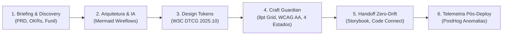

# 🚀 Open UX Harness

> **Agentic Infrastructure & Harness de Alta Performance para Product Designers e Engenharia de Interface**  
> *Agnóstico a modelos de IA | Agnóstico a plataformas | 100% Open Source (MIT)*

[](https://opensource.org/licenses/MIT)
[](https://design-tokens.github.io/community-group/format/)
[](https://www.w3.org/TR/WCAG22/)
[](https://modelcontextprotocol.io/)

---

## 💡 Por que o Open UX Harness existe?

A utilização ingênua de Modelos de Linguagem (LLMs) em Product Design e Desenvolvimento de UI gera dois problemas crônicos documentados pela indústria:

1. **O "Scaffold Effect" (Desperdício de até 40x em Tokens):**  
   Estudos empíricos demonstram que carregar dezenas de ferramentas MCP brutas e transcrições extensas na janela de contexto de um modelo encarece a inferência em até 40 vezes e causa degradação de atenção (*lost-in-the-middle*). Modelos de fronteira contidos num invólucro arquitetural frágil perdem para modelos intermediários contidos em um **harness otimizado**.
2. **"Visual Slop" e Desconexão Técnica:**  
   LLMs sem restrições heurísticas alucinam margens arbitrárias (ex.: 13px, 21px), violam taxas de contraste de acessibilidade (WCAG 2.2), ignoram design systems homologados e geram componentes duplicados em vez de reutilizar código existente.

O **Open UX Harness** é a resposta de engenharia a esses desafios: um ecossistema de orquestração modular que atua como co-piloto estratégico, cobrindo todo o ciclo de vida do design — **do briefing à telemetria de impacto pós-deploy**.

---

## 🌟 Pilares Fundamentais

* **🔄 Totalmente Agnóstico a Motores de IA:**  
  A IA atua como um executor intercambiável (*AI as a commodity*). Troque livremente entre **Claude 3.7 Sonnet / Opus**, **GPT-4o / o3**, **Gemini 2.5 Pro / Flash**, **DeepSeek V3 / R1** ou modelos locais via **Ollama / vLLM**.
* **💻 Agnóstico a Plataformas de Desenvolvimento:**  
  Compila nativamente para **Google Antigravity**, **Claude Code CLI**, **Cursor**, **Windsurf**, **Roo Code**, **Cline** ou **Terminal puro (Codex)**.
* **🎯 Versátil (Do Freelancer à Grande Empresa):**
  * **Modo Freelancer / Lean:** Sem necessidade de infraestrutura pesada. Tokens em JSON simples, protótipos em HTML/Tailwind/React e auditoria local em menos de 5 minutos.
  * **Modo Enterprise / Scale:** Conexão com Figma Console MCP (Desktop Bridge WebSocket), W3C DTCG 2025.10 com linter *asimonim*, Storybook MCP com visual regression Playwright, e telemetria PostHog.
* **🧠 Skill-Driven MCP (Dynamic Pruning):**  
  As **Skills** governam os servidores MCP, ativando apenas as ferramentas estritamente necessárias para a tarefa ativa. Reduz em mais de 70% o inchaço de tokens (*token bloat*).

---

## 🗺️ Ciclo de Vida UX End-to-End no Harness



| Fase | Entregável para o Designer | Perfil Freelancer | Perfil Enterprise |
| :--- | :--- | :--- | :--- |
| **1. Discovery** | Problem Framing & KPIs | Briefing guiado no chat ou Markdown | Ingestão de PRD via Notion/Jira MCP |
| **2. Arquitetura** | Wireflows conceituais | Diagramas Mermaid renderizáveis | Mapeamento estrutural de dependências |
| **3. Tokens** | Contrato de dados de design | `tokens.json` simples + Tailwind config | W3C DTCG com linter `asimonim` |
| **4. Figma** | Telas e Auto Layout | REST API oficial (leitura rápida) | Figma Console MCP (escrita em lote) |
| **5. Craft Guardian** | Blindagem visual e A11y | Linter heurístico 8pt + WCAG 2.2 AA | Scanner axe-core + contraste APCA |
| **6. Handoff** | Código com paridade total | Snippets prontos React/Tailwind/HTML | Storybook MCP + Playwright diff |
| **7. Pós-Deploy** | Medição de impacto real | Feedback qualitativo ou CSVs | Anomalias de funil via PostHog MCP |

---

## ⚡ Guia de Início Rápido (Quickstart)

### 1. Instalação
```bash
git clone https://github.com/open-ux-harness/open-ux-harness.git
cd open-ux-harness
npm install
```

### 2. Escolha o seu Perfil no `harness.config.json`
Edite a propriedade `"profile"` para `"freelance"` ou `"enterprise"`:
```json
{
  "profile": "freelance"
}
```

### 3. Compilar para a sua Plataforma Favorita
Gere os adaptadores nativos para o seu agente com um único comando:
```bash
npm run build:adapters
```
O compilador criará os arquivos de integração prontos para uso em `dist/adapters/`:
- **Antigravity:** `dist/adapters/antigravity/` (`.agentrules`, `mcp_config.json`, skills).
- **Claude Code:** `dist/adapters/claude-code/` (`CLAUDE.md`, `.mcp.json`).
- **Cursor / Windsurf:** `dist/adapters/cursor/` (`.cursorrules`).
- **Terminal CLI:** `dist/adapters/terminal-cli/` (`harness-runtime.json`).

### 4. Executar Comandos Utilitários & Micro-Steering
```bash
# Validar arquivo de Design Tokens contra W3C DTCG
npm run lint:tokens

# Executar varredura determinística Anti-Slop (62 regras de craft visual)
npm run audit:slop examples/checkout-flow/04-component.tsx

# Aplicar playbooks cirúrgicos de micro-steering (bolder, quieter, distill, harden, typeset, polish)
npm run steer bolder "PricingSection"
npm run steer harden "CheckoutForm"

# Simular MCP Dynamic Pruning e verificar economia de tokens
npx ts-node adapters/terminal-cli/src/cli.ts prune 05-craft-and-accessibility

# Executar Craft Guardian Linter (grid 8pt e contraste WCAG)
npx ts-node adapters/terminal-cli/src/cli.ts audit
```

---

## 🛡️ O Craft Guardian & AntiSlopEngine: Eliminando o Visual Slop

Inspirado nas heurísticas e motor de alta precisão do **Impeccable** (`pbakaus/impeccable`), o harness implementa um checklist determinístico obrigatório para qualquer tela ou componente gerado:

- [x] **AntiSlopEngine (62 Regras Determinísticas):**
  - **Bans Absolutos de Slop:** Rejeição de `side-tab` (bordas laterais espessas em cards redondos), `gradient-text` (degradê recortado em títulos), `ai-color-palette` (gradientes roxo/azul padrão), `dark-glow` (halos cromáticos zero-offset), `nested-cards` (cards aninhados dentro de cards) e `kicker-above-heading` (micro-rótulos em caixa alta acima de todo heading).
  - **Integridade & Qualidade:** Detecção de `broken-image`, `cramped-padding` (<8px dentro de contornos), `line-length` (>80ch), `body-text-viewport-edge` (<16px), `tight-leading` (<1.3x) e `tiny-text` (<12px).
- [x] **Surface Modes (Modos de Superfície):** Calibração de ambição estética e restrições por contexto:
  - `Persuade` (Landing pages, conversão): alta expressividade, imagens reais, tipografia marcante.
  - `Operate` (Dashboards, ferramentas SaaS): alta densidade, numerais tabulares, escaneabilidade e moderação visual.
  - `Read` (Docs, artigos): ritmo de leitura, entrelinha confortável e largura 65-75ch.
  - `Experience` (Portfólios, showcases): interface recuada com destaque absoluto para a obra.
- [x] **Grid Espacial de 8 Pontos:** Todos os paddings e margens são múltiplos de 8px (ou 4px defensivo). Valores arbitrários (13px, 7px) são rejeitados.
- [x] **Contraste de Acessibilidade (WCAG 2.2 AA & APCA):** Mínimo 4.5:1 para texto normal e 3.0:1 para elementos de destaque.
- [x] **Cobertura dos 4 Estados de Interface:**
  1. *Default / Happy Path*
  2. *Empty State (orientando a primeira ação)*
  3. *Loading / Skeleton (evitando Layout Shift)*
  4. *Error / Degraded Feedback (com botão de recuperação)*
- [x] **Touch Targets:** Área mínima de toque de 44x44px em mobile e 24x24px em desktop.
- [x] **Superfícies Nativas de Navegador:** Estilos para `::selection`, `caret-color`, `tabular-nums` e scrollbars customizadas.
- [x] **Suporte Bidirecional a DESIGN.md:** Compatibilidade nativa com a especificação aberta `DESIGN.md` (Google Labs standard: tokens YAML frontmatter + 8 seções canônicas de design).

---

## 🏛️ Matriz de Governança (Zero YOLO Mode)

| Ação Pretendida | Nível de Autoridade | Comportamento do Harness |
| :--- | :--- | :--- |
| **Leitura de PRD, Figma, Storybook e Métricas** | `ALLOW` (Verde) | Execução 100% autônoma e silenciosa em background. |
| **Auditoria A11y, Linter e Rascunhos Locais** | `ALLOW` (Verde) | Execução autônoma com relatório em Markdown. |
| **Modificação de Tokens Globais ou Master Components** | `ASK` (Campainha) | Pausa a execução e exige aprovação humana (**Design Gate**). |
| **Criação de Pull Request / Deploy** | `ASK` (Campainha) | Prepara a branch e aguarda aprovação explícita. |
| **Exclusão de Tokens Mestres sem Backup** | `DENY` (Muralha) | Bloqueado terminantemente pelo Guardrail de Segurança. |

---

## 📁 Estrutura do Repositório

```
open-ux-harness/
├── harness.config.json           # Configuração central e seleção de perfil ativo
├── presets/                     # Perfis modulares (freelance.json, enterprise.json)
├── core/                        # Motor agnóstico em TypeScript
│   ├── config-loader.ts         # Carregador de configurações e presets
│   ├── context-engine.ts        # Motor de MCP Pruning e Prompt Caching
│   ├── guardrails.ts            # Matriz Allow / Ask / Deny e Design Gates
│   ├── anti-slop-engine.ts      # 62 Regras determinísticas anti-slop e qualidade de código
│   ├── craft-guardian-linter.ts # Linter de contraste e grid de 8px
│   ├── lint-tokens.ts           # Validador de Design Tokens W3C DTCG
│   ├── design-contract.ts       # Validador de contratos, Surface Modes e DESIGN.md
│   └── memory-manager.ts        # Gestão de memória Semântica, Episódica e Procedural
├── playbooks/                   # Playbooks cirúrgicos de Micro-Steering (bolder, quieter, distill, harden, typeset, polish)
├── skills/                      # Skills agnósticas (Markdown + frontmatter)
├── mcp-registry/                # Registro unificado de servidores MCP e filtros
│   ├── servers.json             # Catálogo de MCPs suportados
│   └── filters/                 # Filtros Server-Side (Figma, Storybook, PostHog)
├── memory/                      # Camadas mnemônicas
│   ├── semantic/                # Diretrizes de marca e OKRs
│   ├── episodic/                # Trajetórias de experimentos (JSONL)
│   └── procedural/              # Checklists imutáveis
├── adapters/                    # Compiladores para Antigravity, Claude, Cursor, Codex
└── templates/                   # Modelos de PRD, Tokens DTCG, Craft Audit e Handoff Spec
```

---

## 🤝 Como Contribuir

Contribuições são muito bem-vindas!
1. Faça um Fork do projeto.
2. Crie uma branch para sua funcionalidade (`git checkout -b feature/nova-skill`).
3. Adicione testes em `core/core.test.ts`.
4. Envie seu Pull Request.

---

## 📄 Licença

Distribuído sob a licença **MIT**. Consulte o arquivo [LICENSE](./LICENSE) para mais detalhes.
