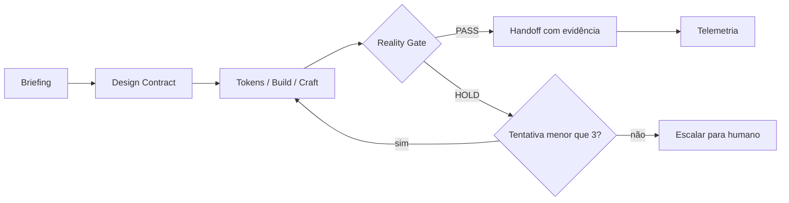

# Inspirações do `agency-agents` para o Open UX Harness

> Análise de [msitarzewski/agency-agents](https://github.com/msitarzewski/agency-agents) (licença MIT) comparada ao estado atual do Open UX Harness.
> As ideias abaixo foram **reescritas e adaptadas**; nenhum texto de agente foi copiado. Esta etapa é só documentação: nenhum código do harness foi alterado.

## 1. Visão geral

O `agency-agents` é uma coleção de cerca de 250 personas de agentes, em 18 "divisões" (engenharia, design, testes, marketing etc.). Cada agente é um arquivo `.md` com frontmatter. Em cima disso há a camada **NEXUS** (`strategy/`), com playbooks por fase, runbooks por cenário e templates de handoff. Um conjunto de scripts converte e instala tudo para 17 ferramentas de IA.

| Dimensão | agency-agents | Open UX Harness (atual) |
|---|---|---|
| Foco | Largura: muitas personas | Profundidade: 8 skills UX + 14 skills LinkedIn, com scripts e schemas |
| Unidade | 1 agente = 1 `.md` | 1 skill = pasta (`SKILL.md`, `assets/`, `references/`, `scripts/`) |
| Orquestração | Fases 0–6, modos Full/Sprint/Micro, orquestrador, loop Dev↔QA (máx. 3 tentativas) | Ciclo linear de 7 fases, sem loop de retry |
| Qualidade | Reality Checker (padrão "NEEDS WORK"), UI Finish-Gate (PASS/HOLD), Evidence Collector | Craft Guardian: grid 8pt, WCAG, 4 estados, linter determinístico |
| Distribuição | `tools.json` como fonte única, `convert.sh`/`install.sh`, instalação por divisão ou agente | `build-adapters.ts` para 4 plataformas |
| Governança do repo | `divisions.json`, `lint-agents.sh`, `check-*.sh`, cerca de 25 testes de shell, CI | `core.test.ts` |
| Memória | Servidor MCP com `remember`, `recall` e `rollback` | Memória semântica, episódica e procedural local |

**O que o harness já faz melhor e deve ser preservado:**
- MCP Dynamic Pruning.
- Guardrails Allow/Ask/Deny.
- Scripts determinísticos por skill.
- Tokens W3C DTCG.

O agency-agents é quase todo baseado em prompts e tem pouca verificação automática.

## 2. Inspirações priorizadas

Esforço e impacto são estimativas minhas (B = baixo, M = médio, A = alto).

### P0: maior retorno, menor esforço

#### 2.1 Gate de realidade (PASS / HOLD)
- **Origem:** `testing/testing-reality-checker.md`, `design/design-ui-finish-gate-reviewer.md`.
- **O que fazem:** o avaliador parte de "NEEDS WORK". Nota perfeita de um agente anterior é tratada como sinal de alerta. Cada afirmação exige evidência (screenshots, arquivos, resultados de teste). O veredito é binário (**PASS** ou **HOLD**), sem lista vaga de "melhorias desejáveis".
- **Lacuna:** o Craft Guardian verifica regras (8pt, contraste, estados), mas não exige evidência visual nem tem um veredito final.
- **Proposta:**
  - Criar a skill `08-reality-gate`.
  - Adicionar o campo `verdict: PASS|HOLD` em `templates/craft-audit-report.md`.
  - Exigir capturas em desktop, tablet e mobile antes do handoff.
  - Tratar score perfeito como suspeito.
- **Esforço/Impacto:** B / A.

#### 2.2 Design Contract contra "visual slop"
- **Origem:** `design/design-ui-finish-gate-reviewer.md`.
- **O que faz:** antes de criticar, registra quem usa a tela, qual o trabalho principal, qual o fluxo mais frequente e quais objetos do domínio importam. Lista 3 a 5 referências reais e os padrões genéricos **proibidos** para aquele produto (gradientes decorativos, grid de cards sem hierarquia, empty state genérico).
- **Lacuna:** o harness combate slop com regras técnicas, mas não com especificidade de produto.
- **Proposta:**
  - Criar `templates/design-contract.md`, preenchido na fase 1 (briefing).
  - O Craft Guardian e o Reality Gate passam a usá-lo como critério.
- **Esforço/Impacto:** B / A.

#### 2.3 Loop Dev↔QA com limite de tentativas
- **Origem:** `specialized/agents-orchestrator.md`, `strategy/coordination/handoff-templates.md`.
- **O que faz:** cada tarefa só avança se passar no QA. Se falhar, volta com feedback específico. Depois de 3 tentativas, escala para humano.
- **Lacuna:** os guardrails cobrem permissão (Allow/Ask/Deny), mas não retry nem escalonamento.
- **Proposta:**
  - Adicionar `retryPolicy: { maxAttempts: 3, onExhausted: "escalate" }` em `harness.config.json`.
  - Implementar a lógica em `core/guardrails.ts`.
  - Registrar cada tentativa no log episódico.
- **Esforço/Impacto:** M / A.

#### 2.4 Templates de handoff padronizados
- **Origem:** `strategy/coordination/handoff-templates.md`.
- **O que faz:** trata perda de contexto como a principal causa de falha entre agentes. Padroniza metadados (de/para, fase, prioridade, data), contexto, critérios de aceite mensuráveis, evidência exigida, e variantes de PASS, FAIL e escalonamento.
- **Proposta:**
  - Estender `templates/handoff-spec.md` e a skill `06-zero-drift-handoff` com o bloco de critérios de aceite e evidência.
  - Adicionar modelos de veredito PASS, FAIL (com número da tentativa) e escalonamento.
- **Esforço/Impacto:** B / M.

### P1: estrutura e completude

#### 2.5 Modos de ativação Full / Sprint / Micro
- **Origem:** `strategy/QUICKSTART.md`, `strategy/runbooks.json`.
- **O que faz:** dimensiona a equipe pelo tamanho da tarefa: produto completo, feature, ou tarefa pontual.
- **Proposta:**
  - Adicionar o campo `mode` aos presets em `presets/*.json`.
  - Cada modo ativa um subconjunto de skills. Exemplo: Micro = `05-craft-and-accessibility` + `06-zero-drift-handoff`; Sprint = fases 1–6; Full = todas.
  - Isso reduz tokens e dá ao freelancer um caminho rápido.
- **Esforço/Impacto:** M / A.

#### 2.6 Runbooks por cenário, validados por script
- **Origem:** `strategy/runbooks.json`, `strategy/runbooks/*.md`, `scripts/check-runbooks.sh`.
- **O que faz:** cada cenário (MVP, feature enterprise, incidente, campanha) lista os agentes por grupo e momento de ativação. Um script garante que tudo o que o runbook cita existe.
- **Proposta:**
  - Criar `runbooks/runbooks.json` com cenários de UX: redesign de checkout, auditoria de design system, landing page, perfil e portfólio no LinkedIn.
  - Criar `npm run lint:runbooks`, que verifica se toda skill citada existe.
  - Reaproveitar `examples/checkout-flow` como o primeiro runbook.
- **Esforço/Impacto:** M / M.

#### 2.7 Persona Walkthrough
- **Origem:** `design/design-persona-walkthrough.md`.
- **O que faz:** simula a leitura de uma página scroll a scroll, do ponto de vista de uma persona. Inclui o teste dos 5 segundos (o que é isto? é para mim? o que faço?). Produz duas vozes separadas: o monólogo da persona e a análise estruturada. Avisa em todo relatório que o resultado é hipótese qualitativa, não evidência estatística.
- **Proposta:**
  - Adicionar como etapa opcional em `01-briefing-discovery`.
  - Também serve ao `li-profile` (olhar de recrutador) e ao `li-post`.
- **Esforço/Impacto:** M / M.

#### 2.8 Frontmatter padrão e lint de skills
- **Origem:** `scripts/lint-agents.sh`.
- **O que faz:** valida campos obrigatórios, seções recomendadas (Identity, Core Mission, Critical Rules) e cores válidas. Roda no CI.
- **Proposta:**
  - Estender o validador do `00-skill-architect` e expor `npm run lint:skills`.
  - Padronizar frontmatter (`name`, `description`, `phase`, `mcp`, `inputs`, `outputs`).
  - Validar que toda skill em `activeSkills` tem pasta e `SKILL.md`.
- **Esforço/Impacto:** B / M.

#### 2.9 Fonte única para plataformas
- **Origem:** `tools.json`, `scripts/convert.sh`.
- **O que faz:** um único JSON descreve cada ferramenta: formato de saída, diretórios de destino por escopo (usuário ou projeto), como detectar a instalação, como obter a versão. Um script de CI falha se o JSON e o código divergirem.
- **Proposta:**
  - Criar `adapters/platforms.json` e fazer `build-adapters.ts` ler dele.
  - Adicionar Gemini CLI, Copilot, Windsurf, OpenCode e Codex.
  - Ao adicionar uma plataforma, só o JSON e um renderizador mudam.
- **Esforço/Impacto:** M / A.

### P2: polimento e escala

| # | Inspiração | Origem | Proposta |
|---|---|---|---|
| 2.10 | Instalação seletiva (`--list`, `--dry-run`, por skill) | `scripts/install.sh` | CLI `harness install --skills 03,05 --dry-run` |
| 2.11 | Memória com `rollback` | `examples/workflow-with-memory.md` | Expor `rollback` em `core/memory-manager.ts` para voltar ao estado anterior após um HOLD |
| 2.12 | Conhecimento de agentes de UX adjacentes | `testing-accessibility-auditor`, `design-ux-researcher`, `design-inclusive-visuals-specialist`, `design-brand-guardian`, `design-whimsy-injector`, `product-behavioral-nudge-engine` | Absorver como `references/` das skills existentes (por exemplo, auditoria com leitor de tela em `05-craft`), **não** como novas personas |
| 2.13 | Testes em camadas e CI | `scripts/test-*.sh`, `.github/workflows` | Ampliar `core.test.ts`; adicionar GitHub Actions rodando lint, testes e build de adapters |
| 2.14 | Guarda de originalidade | `scripts/check-agent-originality.sh` | Opcional, se o harness aceitar contribuições externas |

## 3. Fluxo proposto

## 4. O que NÃO adotar

- **Divisões irrelevantes para UX** (GIS, jogos, finanças, saúde, vendas, marketing chinês, blockchain): não agregam ao público do harness.
- **Escala de centenas de personas:** aumenta o custo de contexto e contradiz o princípio de Dynamic Pruning, que é o diferencial do harness.
- **Personalidade e "vibe" como eixo:** o harness é guiado por critérios verificáveis, não por tom de persona. Se algo for aproveitado, que seja só o rótulo curto.
- **Verificação só por prompt:** o ponto forte do harness são os scripts determinísticos. Todo gate novo deve ter um componente automatizável.

## 5. Roadmap sugerido

| Fase | Itens | Resultado |
|---|---|---|
| A | 2.1, 2.2, 2.3, 2.4 | Qualidade verificável e handoffs sem perda de contexto |
| B | 2.5, 2.6, 2.8, 2.9, 2.7 | Modos de uso, cenários prontos e mais plataformas |
| C | 2.10 a 2.14 | Escala, CI e manutenção |

## 6. Riscos

- **Duplicação com o Craft Guardian:** o Reality Gate deve consumir o relatório do Craft Guardian, não repeti-lo.
- **Inchaço de contexto:** cada skill nova deve entrar em `activeSkills` só no modo que a usa.
- **Manutenção:** `platforms.json` e o lint de skills só valem se rodarem no CI. Sem isso, divergem com o tempo.
- **Persona Walkthrough:** é simulação qualitativa. Os relatórios devem rotular os achados como hipóteses a validar.

## 7. Referências no repositório analisado

- `README.md`, `divisions.json`, `tools.json`
- `strategy/nexus-strategy.md`, `strategy/QUICKSTART.md`, `strategy/runbooks.json`
- `strategy/coordination/handoff-templates.md`
- `specialized/agents-orchestrator.md`
- `testing/testing-reality-checker.md`
- `design/design-ui-finish-gate-reviewer.md`, `design/design-persona-walkthrough.md`
- `examples/workflow-with-memory.md`
- `scripts/lint-agents.sh`, `scripts/convert.sh`, `scripts/install.sh`
