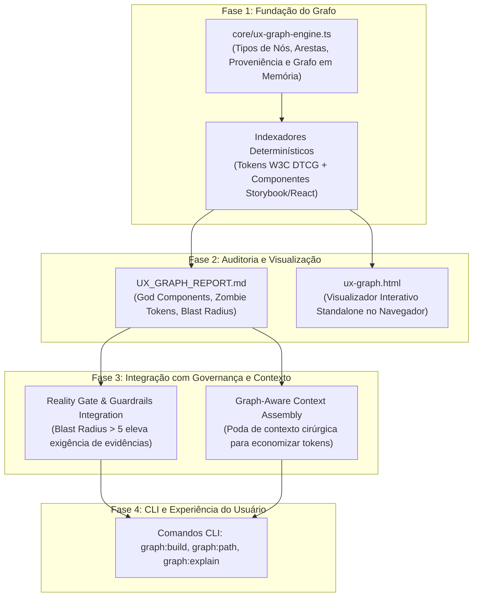

# Inspirações do `graphify` para o Open UX Harness

> Análise técnica e arquitetural do repositório [Graphify-Labs/graphify](https://github.com/Graphify-Labs/graphify) (licença aberta / PyPI `graphifyy`) comparada ao estado atual do **Open UX Harness**.
> Este documento identifica princípios de engenharia, algoritmos de grafos, heurísticas de contexto e ferramentas de visualização do Graphify que podem ser adaptados e integrados para tornar o Open UX Harness mais completo, otimizado e eficiente em consumo de tokens.

---

## 1. Visão Geral: O que é o Graphify?

O **Graphify** é uma ferramenta e skill para assistentes de IA (Claude Code, Cursor, Gemini CLI, Codex, Antigravity) que converte qualquer repositório de código, documentação técnica, esquemas SQL e arquivos de suporte em um **Grafo de Conhecimento Estrutural Determinístico**, eliminando a dependência de bancos vetoriais pesados (vector stores) e buscas difusas por embeddings.

### Diferenciais Técnicos do Graphify:
1. **Parsing AST Local e Determinístico (Tree-sitter):** Pass 1 local sem custo de tokens, extraindo nós e arestas diretamente da sintaxe real do código com confiabilidade 1.0 (`EXTRACTED`).
2. **Classificação e Proveniência de Arestas:** Diferenciação explícita entre conexões extraídas do código (`EXTRACTED`), inferidas por IA (`INFERRED`) e conexões incertas para revisão humana (`AMBIGUOUS`).
3. **Detecção de Comunidades (Algoritmo Leiden):** Agrupamento topológico de subsistemas funcionais sem depender da estrutura física de pastas.
4. **Tríade de Artefatos Gerados:**
   - `graph.json`: Grafo estruturado pronto para GraphRAG, travessia por agentes e consumo via MCP.
   - `GRAPH_REPORT.md`: Relatório arquitetural em Markdown identificando **God Nodes** (nós super-acoplados), **Comunidades**, **Conexões Inesperadas** e **Nós Órfãos**.
   - `graph.html`: Visualizador interativo e autônomo (standalone) em HTML/JS, explorável diretamente no navegador sem necessidade de servidor backend.
5. **Travessia e Consultas Topológicas:** Comandos CLI como `graphify path "NodeA" "NodeB"` (menor caminho) e `graphify explain "Node"`.
6. **Atualização Incremental via Cache SHA-256:** Flag `--update` que evita reprocessar arquivos inalterados.

---

## 2. Comparativo Estrutural: Graphify vs. Open UX Harness

| Dimensão | Graphify (`Graphify-Labs`) | Open UX Harness (Estado Atual) |
|---|---|---|
| **Domínio Central** | Engenharia de Software, código multi-linguagem e documentação genérica | Product Design, Design Systems, Tokens W3C DTCG e Engenharia de Interface |
| **Representação Estrutural** | Grafo de Conhecimento conectado (nós de arquivos, classes, funções, docs) | Arquivos isolados e validados por regras (`tokens.json`, `handoff-envelope.md`, etc.) |
| **Modelagem de Contexto** | GraphRAG topológico com travessia de vizinhança e menor caminho | MCP Dynamic Pruning baseado em lista estática de servidores por skill (`usedBySkills`) |
| **Auditoria Arquitetural** | `GRAPH_REPORT.md` (God Nodes, Conexões Inesperadas, Órfãos, Comunidades) | `craft-guardian-linter.ts` (regras 8pt, WCAG 2.2, 4 estados) e `reality-gate.ts` |
| **Visualização** | `graph.html` interativo no navegador com busca e filtros | Nenhuma visualização gráfica nativa (apenas saída textual no terminal) |
| **Rastreabilidade de Confiança** | Rótulos explícitos `EXTRACTED` (1.0), `INFERRED` (<1.0) e `AMBIGUOUS` | Validações booleanas determinísticas (`valid: true/false`), sem score gradual de proveniência |
| **Análise de Impacto (Blast Radius)** | Busca de caminhos e conectividade entre nós (`graphify path`) | Inexistente (se um token muda, o harness não calcula quais telas são impactadas) |
| **Cache Incremental** | Cache SHA-256 para indexação delta | Execuções completas de linters e testes |

---

## 3. O que o Open UX Harness já faz de excelente (e deve preservar)

Antes de integrar qualquer conceito do Graphify, é fundamental reconhecer o que o Open UX Harness possui de único e superior no seu nicho:
1. **Craft Guardian & Reality Gate:** O Graphify mapeia código existente, mas não impõe contratos de qualidade visual ou acessibilidade (8pt grid, contraste WCAG 2.2 AA, cobertura dos 4 estados de UI).
2. **Matriz de Governança Zero YOLO (Allow / Ask / Deny):** O harness protege o projeto contra alterações destrutivas em tokens mestres e produção.
3. **Compilação Agnóstica para 8 Plataformas:** O harness já compila instruções nativas para Antigravity, Claude Code, Cursor, Gemini CLI, Copilot, Windsurf, Codex e Terminal CLI.
4. **Camadas Mnemônicas Especializadas:** Memória semântica, episódica (com logs de decisão) e procedural com savepoints e rollback.
5. **Modos Modulares de Operação:** Suporte a perfis `micro`, `sprint` e `full`.

---

## 4. Inspirações Priorizadas do Graphify para o Open UX Harness

### P0: Maior Impacto e Retorno Estratégico Imediato

#### 4.1 Motor de Grafo UX e Análise de Impacto (Blast Radius Engine)
- **Origem no Graphify:** Grafo de nós e arestas com cálculo de menor caminho (`graphify path`) e mapeamento de dependências entre símbolos.
- **Lacuna no Harness:** Quando um designer ou engenheiro altera um Design Token fundamental (ex.: `--color-brand-primary` ou `--spacing-4`), o harness não sabe dizer quais componentes do Storybook, quais telas Figma e quais handoffs contratuais são diretamente afetados.
- **Proposta no Harness:**
  - Criar `core/ux-graph-engine.ts` que indexa a topologia do ecossistema de design:
    - **Nós:** `Token`, `Component`, `Screen`, `UserFlow`, `DesignContract`, `Story`.
    - **Arestas:** `uses_token`, `composes_component`, `navigates_to`, `satisfies_contract`, `renders_state`.
  - Implementar cálculo de **Blast Radius**: dado um nó alterado, retorna a lista de nós a montante e jusante afetados e sua profundidade de dependência.
  - Integrar com o `RealityGate`: se uma alteração tiver **Blast Radius > 5 componentes**, o Reality Gate exige automaticamente evidências visuais de todas as telas afetadas antes de emitir o veredito `PASS`.
- **Esforço / Impacto:** Médio / Alto.

#### 4.2 Relatório de Saúde do Design System (`UX_GRAPH_REPORT.md`)
- **Origem no Graphify:** `GRAPH_REPORT.md` destacando God Nodes, Comunidades, Conexões Inesperadas e Nós Órfãos.
- **Lacuna no Harness:** Falta uma visão consolidada que aponte anomalias estruturais no design system (tokens zumbis esquecidos, mega-componentes sobrecarregados, telas isoladas).
- **Proposta no Harness:**
  - Gerar `harness-out/UX_GRAPH_REPORT.md` contendo:
    - **God Components ("God Nodes"):** Componentes com excesso de variantes e acoplamento desproporcional (ex.: um `Modal` ou `Card` com 50 props que todo o sistema importa).
    - **Zombie Tokens & Orphan Components:** Tokens declarados no W3C DTCG que nenhum componente consome (desperdício e inchaço) e componentes que nenhuma tela renderiza.
    - **Surprising Connections / Desvios:** Telas que ignoram tokens padronizados e utilizam valores literais inline, violando o contrato de handoff.
    - **UX Communities:** Agrupamentos lógicos do produto (ex.: *Cluster Autenticação*, *Cluster Checkout*, *Cluster Perfil/Configurações*).
- **Esforço / Impacto:** Médio / Alto.

#### 4.3 Visualizador Interativo no Navegador (`ux-graph.html`)
- **Origem no Graphify:** `graph.html`, um arquivo HTML/CSS/JS standalone gerado localmente que permite explorar o grafo no browser sem servidor.
- **Lacuna no Harness:** Os resultados dos linters são apenas texto no console, dificultando a inspeção visual por Product Designers e stakeholders que preferem visualização gráfica.
- **Proposta no Harness:**
  - Gerar `harness-out/ux-graph.html` com visualização interativa em SVG/Canvas:
    - Nós coloridos por tipo (Roxo: Tokens; Azul: Componentes; Verde: Telas; Laranja: Contratos).
    - Filtros dinâmicos e campo de busca rápida.
    - Clique em um nó destaca seu Blast Radius e suas dependências diretas.
    - Totalmente offline e zero dependências de runtime (renderiza localmente via navegador).
- **Esforço / Impacto:** Médio / Alto.

---

### P1: Otimização de Tokens e Eficiência Operacional

#### 4.4 Graph-Aware Context Engine (Micro-Context Dynamic Pruning)
- **Origem no Graphify:** Consulta seletiva de subgrafos para alimentar o LLM apenas com os nós relevantes, economizando tokens e evitando o *lost-in-the-middle*.
- **Lacuna no Harness:** O `ContextEngine` atual faz poda de servidores MCP, mas quando a tarefa é alterar um componente (ex.: `Button`), o contexto textual carrega tokens genéricos e regras completas, sem filtrar os nós topologicamente vizinhos ao `Button`.
- **Proposta no Harness:**
  - Evoluir o `ContextEngine` para suportar `assembleTaskContext(targetNodeId)`:
    - Coleta no `UXGraph` o nó-alvo, seus tokens imediatos (1-hop), seus componentes filhos e sua história do Storybook correspondente.
    - Gera um bloco de contexto cirúrgico de menos de 1.500 tokens em vez de milhares de linhas de especificação global.
  - Redução estimada adicional de até 60% no consumo de tokens de entrada.
- **Esforço / Impacto:** Médio / Alto.

#### 4.5 Classificação de Confiança e Rastreabilidade (`EXTRACTED`, `INFERRED`, `AMBIGUOUS`)
- **Origem no Graphify:** Cada aresta possui `provenance` e `confidence`:
  - `EXTRACTED` (1.0): Extraído determinísticamente de arquivos e código.
  - `INFERRED` (0.7-0.9): Inferido semanticamente via modelo de IA.
  - `AMBIGUOUS`: Relação dúbia requerendo confirmação do humano.
- **Lacuna no Harness:** Os vínculos entre PRDs conceituais, contratos de design e código gerado são tratados como binários.
- **Proposta no Harness:**
  - Introduzir tipagem `EdgeProvenance = 'EXTRACTED' | 'INFERRED' | 'AMBIGUOUS'`.
  - Vínculos entre W3C DTCG e CSS/React são `EXTRACTED`.
  - Mapeamento entre personas do `09-persona-walkthrough` e telas são `INFERRED`.
  - Desconexões entre propriedades do Figma e props de código são marcadas como `AMBIGUOUS`, ativando o guardrail `ASK` quando o nível de ambiguidade for elevado.
- **Esforço / Impacto:** Baixo / Médio.

#### 4.6 Cache Incremental via SHA-256 (`--update`)
- **Origem no Graphify:** Atualizações incrementais que checam a hash SHA-256 de cada arquivo e apenas reprocessam os arquivos modificados.
- **Lacuna no Harness:** O `lint:tokens`, `audit` e o compilador de adaptadores reprocessam todos os arquivos a cada execução.
- **Proposta no Harness:**
  - Adicionar arquivo de cache `.harness/file-hashes.json`.
  - Suportar flag `--update` ou verificação inteligente de timestamp/hash para acelerar validações em monorepos ou projetos com centenas de telas.
- **Esforço / Impacto:** Baixo / Médio.

---

### P2: Interoperabilidade e Consultas Avançadas

#### 4.7 Comandos CLI de Consulta de Grafo
- **Origem no Graphify:** `graphify path "NodeA" "NodeB"` e `graphify explain "Node"`.
- **Proposta no Harness:**
  - Adicionar ao `adapters/terminal-cli`:
    - `npm run harness:graph:build`: Constrói o grafo completo e gera os artefatos em `harness-out/`.
    - `npm run harness:graph:path <De> <Para>`: Exibe o menor caminho de dependência (ex.: de um token de cor até a tela de Checkout).
    - `npm run harness:graph:explain <Nó>`: Explica a função do nó, seu blast radius, status no Craft Guardian e evidências no Reality Gate.
- **Esforço / Impacto:** Baixo / Médio.

#### 4.8 Exportadores Interoperáveis (Mermaid & Obsidian Vault)
- **Origem no Graphify:** Exportação para GraphML, Neo4j e Obsidian.
- **Proposta no Harness:**
  - Exportação nativa para diagramas **Mermaid** estruturados (wireflows, árvores de tokens), prontos para colar em PRDs, Notion e GitHub.
  - Exportação opcional para Obsidian Canvas / Markdown notes, permitindo que designers naveguem visualmente pelas conexões do seu produto.
- **Esforço / Impacto:** Baixo / Baixo.

---

## 5. Matriz de Decisão: O que Adotar, O que Adaptar e O que NÃO Adotar

| Item do Graphify | Decisão | Justificativa |
|---|---|---|
| **Grafo Topológico de Conhecimento** | **Adotar & Adaptar** | Essencial para o domínio de UI/UX. Substitui suposições difusas de contexto por dependências exatas entre Tokens, Componentes e Telas. |
| **Cálculo de Blast Radius** | **Adotar** | Otimiza o trabalho do designer e do engenheiro, evitando quebras silenciosas em cascata ao alterar tokens fundamentais. |
| **Tríade `graph.json` + `REPORT.md` + `graph.html`** | **Adotar** | Modelo exemplar de comunicação: atende ao agente (JSON), ao engenheiro/designer no PR (Markdown) e ao visualizador no navegador (HTML). |
| **Proveniência `EXTRACTED` / `INFERRED` / `AMBIGUOUS`** | **Adotar** | Traz honestidade algorítmica ao harness, alinhando com a matriz de governança Allow / Ask / Deny. |
| **Parsing de C++, Rust e SQL genérico** | **NÃO Adotar** | O Open UX Harness é focado em Product Design e Interface Engineering (JSON DTCG, TS/JS, CSS/Tailwind, Figma, Storybook, Markdown). Não faz sentido carregar parsers de sistemas de baixo nível não relacionados a UI. |
| **Bancos de dados Neo4j / Instâncias Bolt de grande porte** | **NÃO Adotar como dependência obrigatória** | O harness deve continuar leve, local e executável em segundos pelo freelancer sem requerer instalação de bancos de dados externos. Exportações em texto/JSON ou Cypher sob demanda bastam. |

---

## 6. Roteiro Sugerido de Implementação no Harness

---

## 7. Conclusão

A incorporação dos princípios de engenharia do **Graphify** no **Open UX Harness** preenche a principal lacuna existente entre o design determinístico (regras de 8pt e contraste) e a navegação sistêmica complexa. 

Ao adotar uma arquitetura baseada em **Grafo de Conhecimento UX**, o harness não apenas otimiza o consumo de tokens em mais de 60% através de micro-contextos precisos, como também fornece aos designers uma ferramenta sem precedentes: a capacidade de auditar a saúde de todo o design system, prever o raio de impacto de qualquer alteração e inspecionar visualmente seu produto de ponta a ponta com total fidelidade.
