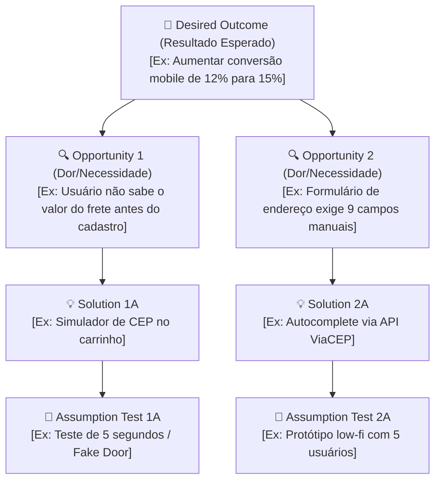

# Documento de Validação de Escopo e Problem Framing

> **Status:** [Rascunho Inicial | Em Revisão com Stakeholders | Aprovado para Execução]  
> **Data:** [AAAA-MM-DD]  
> **Liderança de Design:** [Nome do Lead / UX Designer]  
> **Produto / Iniciativa:** [Nome do Produto ou Módulo]  
> **Perfil Operacional:** [Freelance / Lean | Enterprise / Scale]  

---

## 1. Resumo Executivo
[Breve parágrafo de 3 a 5 linhas sintetizando o que é o projeto, qual oportunidade estratégica ele aborda e seu propósito fundamental para a organização].

---

## 2. Definição do Problema (Causa Raiz & Custo da Inação)
- **Declaração do Problema:** [Declaração clara e concisa da dor principal que será resolvida, separando a causa raiz dos sintomas superficiais].
- **Custo da Inação (Cost of Inaction - COI):** [O impacto financeiro quantificado, operacional, de churn ou de reputação caso a empresa decida não agir nos próximos 90 dias. Fórmula base: `COI = (Usuários Afetados × Taxa de Perda × Ticket Médio/LTV) + Custo Operacional de Suporte`].
- **Evidências Atuais:** [Fontes de dados que comprovam a existência do problema: tickets de suporte, gravações, métricas analíticas do PostHog/GA].

---

## 3. Objetivos e Resultados de Negócios (Business Outcomes)
- **Objetivo Estratégico:** [Alinhamento com OKR ou meta corporativa do trimestre].
- **Business KPIs Primários:**
  - *Métrica Principal:* [Ex.: Aumentar a taxa de conversão de checkout de 12% para 15%].
  - *Métrica Secundária:* [Ex.: Reduzir chamados de suporte relacionados a pagamento em 25%].
- **Métricas de Experiência (UX Metrics):**
  - *Eficiência:* [Ex.: Reduzir Time-on-Task de 4m30s para menos de 2m].
  - *Qualidade/Satisfação:* [Ex.: CSAT >= 85 pontos / Taxa de erro na etapa de endereço < 2%].

---

## 4. O Usuário
- **Perfil / Persona Alvo:** [Para quem estamos desenhando: perfil demográfico, contexto de uso e nível de familiaridade digital].
- **Momento da Dor (Journey Trigger):** [Em qual instante exato da jornada o usuário se depara com a barreira].
- **Job-to-be-Done (JTBD):** *"Quando eu [situação], eu quero [motivação/ação], para que eu possa [resultado esperado]."*

---

## 5. Fundações Visuais, Brand Identity & Craft Existente (Crítico para Freelancers)
- **Paleta de Cores da Marca:**
  - *Cor Primária (Brand/CTA):* `[#HEX]` - [Nome/Uso]
  - *Cor Secundária (Apoio):* `[#HEX]` - [Nome/Uso]
  - *Superfície / Background:* `[#HEX]` - [Claro/Escuro]
  - *Texto Principal:* `[#HEX]` - [Contraste >= 4.5:1]
- **Tipografia:** [Família de fontes adotada, ex.: Inter, Roboto, Montserrat / Fontes do sistema].
- **Tom de Voz da Marca (Brand Voice):** [Formal / Casual / Técnico / Acolhedor] — *Anti-patterns proibidos:* [Palavras ou abordagens que a marca nunca deve utilizar].
- **Convenções de Craft do Sistema Existente:**
  - *Raio de Borda (Corner Radius):* [Sharp (0-2px) | Equilibrado (6-8px) | Pill (16px+)]
  - *Biblioteca de Ícones:* [Lucide | Heroicons | Material Icons | Outros]
  - *Densidade de Layout:* [Compacto / Arejado]

---

## 6. Escopo e Restrições
- **Dentro do Escopo (In-Scope):**
  - [ ] [Item 1: Ex. Redesenho da etapa de seleção de frete e pagamento mobile]
  - [ ] [Item 2: Ex. Criação de novos tokens de feedback visual de erro]
  - [ ] [Item 3: Ex. Adaptação do componente de cartão para 1-clique]
- **Fora do Escopo (Out-of-Scope):**
  - ❌ [Item 1: Ex. Reformulação do gateway de pagamento ou backend de faturamento]
  - ❌ [Item 2: Ex. Versão para aplicativo nativo iOS/Android (foco restrito à web móvel)]
- **Restrições Técnicas & Prazos:**
  - *Tecnologia Frontend:* [React, Tailwind CSS, Web Components legados]
  - *Dependências de API:* [API REST v2 com latência média de 400ms]
  - *Prazo Inegociável de Handoff:* [Data limite para repasse para a squad de engenharia]

---

## 7. Matriz RACI (Governança do Projeto)

| Stakeholder / Papel | Nome / Área | Categoria RACI | Escopo de Atuação e Autoridade |
| :--- | :--- | :---: | :--- |
| **UX/UI Designer** | [Nome] | **R** *(Responsible)* | Conduz a pesquisa, desenha os fluxos, tokens e protótipos |
| **Product Manager / Sponsor** | [Nome] | **A** *(Accountable)* | Aprovação final de escopo, negócio e poder de veto |
| **Tech Lead / Frontend Lead** | [Nome] | **C** *(Consulted)* | Consulta mandatória sobre viabilidade técnica e arquitetura |
| **Customer Support / Vendas** | [Nome] | **C** *(Consulted)* | Validação de dúvidas frequentes e dores históricas de clientes |
| **Marketing / Growth** | [Nome] | **I** *(Informed)* | Notificados de cronogramas para alinhamento de campanhas |
| **Equipe de QA / Testes** | [Nome] | **I** *(Informed)* | Notificados sobre critérios de aceitação e fluxos previstos |

*Legenda RACI:*  
- **R (Responsible):** Quem executa a tarefa.  
- **A (Accountable):** Quem tem poder de veto e aprovação final (apenas 1 pessoa).  
- **C (Consulted):** Especialistas consultados bidirecionalmente antes das decisões.  
- **I (Informed):** Partes notificadas unidirecionalmente sobre o progresso.

---

## 8. Recomendações de UX Discovery & Opportunity Solution Tree (Teresa Torres)

### 8.1 Árvore de Oportunidades e Soluções (Opportunity Solution Tree - OST)
Mapeamento estruturado conectando o resultado de negócio às dores reais do usuário antes de comprometer engenharia:



- **Desired Outcome (Resultado Desejado):** [Métrica de negócio/produto que guia a árvore]
- **Opportunities (Dores, Necessidades e Desejos do Usuário):**
  - *Oportunidade 1:* [Fricção real mapeada no comportamento do usuário]
  - *Oportunidade 2:* [Fricção secundária mapeada]
- **Solutions (Soluções Candidatas):**
  - *Solução 1A:* [Proposta de intervenção de design/produto]
- **Assumption Tests (Testes de Suposição Rápidos):**
  - *Teste 1A:* [Como validar a suposição mais arriscada antes do código]

### 8.2 Veredito de Discovery Preliminar
Com base na avaliação de incertezas e riscos mapeados:

- [ ] **Apto para Prototipação Imediata:** *(Se todas as premissas críticas tiverem Risco < 15 e forem baseadas em dados)*.
- [ ] **Necessidade de UX Discovery Preliminar:** *(Obrigatório se houver premissas com Risco >= 15)*.

#### Ações de Discovery Recomendadas (se aplicável):
1. **[Método, ex: 5 Entrevistas em Profundidade com Usuários Móveis]**
   - *Por que é indispensável:* [Justificativa do risco de desenhar no escuro].
   - *Impacto esperado:* [O que esperamos descobrir].
2. **[Método, ex: Auditoria Heurística de Checkout & Benchmarking Competitivo]**
   - *Por que é indispensável:* [Mapear quebras de usabilidade antes de propor o novo layout].
   - *Impacto esperado:* [Economizar dias de iteração visual no Figma].

---

## 9. Entregáveis Finais do Projeto
1. **Arquitetura de Informação & Wireflows:** Diagramas conceituais em Mermaid.js documentando todos os caminhos.
2. **Contrato de Design Tokens:** Arquivo W3C DTCG 2025.10 validado por linter.
3. **Protótipo Interativo no Figma:** Componentes com Auto Layout, variantes e cobertura dos 4 estados (*default, empty, loading, error*).
4. **Relatório de Craft & A11y:** Auditoria comprovando pontuação mínima de 90/100 e conformidade WCAG 2.2 AA.
5. **Especificação de Handoff Zero-Drift:** Documentação de props, classes Tailwind e Storybook.

---

## 10. Critérios de Sucesso Pós-Deploy
| Critério / Indicador | Meta Estabelecida | Método de Verificação |
| :--- | :--- | :--- |
| Taxa de Conversão do Fluxo | Aumento mínimo de +[X]% em [Y] dias | PostHog / Google Analytics |
| Taxa de Conclusão de Tarefa | >= 90% dos usuários que entram concluem | Funil Analítico |
| Chamados de Dúvida / Suporte | Redução de [Z]% na categoria pagamento | Helpdesk / Zendesk |
| Acessibilidade em Produção | Zero apontamentos críticos de leitor de tela | Auditoria Lighthouse / Axe-Core |

---

## 11. Roteamento de Próximos Passos no Harness (Next Steps Decision Box)

Com o Problem Framing e as Fundações de Marca validadas, o designer possui **duas alternativas principais de continuidade** para avançar na esteira:

```
┌────────────────────────────────────────────────────────────────────────────────────────────────┐
│  🧭 ROTEAMENTO DE PRÓXIMO PASSO NO HARNESS                                                    │
├────────────────────────────────────────────────────────────────────────────────────────────────┤
│                                                                                                │
│  [CAMINHO A] Arquitetura de Informação & Wireflows (Skill 02) [RECOMENDADO]                   │
│  • Quando escolher: O projeto envolve múltiplas telas, decisões condicionais do usuário ou    │
│    reestruturação de navegação onde desenhar fluxos conceituais antes do visual poupa retrabalho│
│  • Próxima Ação: Acionar a Skill '02-information-architecture'                                 │
│  • Prompt Pronto para o Chat:                                                                  │
│    "Prossiga para a Skill 02 (Arquitetura de Informação) e gere o wireflow Mermaid do fluxo."  │
│                                                                                                │
│  [CAMINHO B] Formalização de Design Tokens & UI (Skill 03)                                     │
│  • Quando escolher: A navegação já é óbvia (ex.: tela única ou modal) e o foco principal é     │
│    estruturar os tokens de cor, tipografia e espaçamentos no padrão W3C/Tailwind para código.  │
│  • Próxima Ação: Acionar a Skill '03-design-tokens'                                            │
│  • Prompt Pronto para o Chat:                                                                  │
│    "Prossiga para a Skill 03 (Design Tokens) e gere a biblioteca de tokens a partir da marca." │
│                                                                                                │
└────────────────────────────────────────────────────────────────────────────────────────────────┘
```
