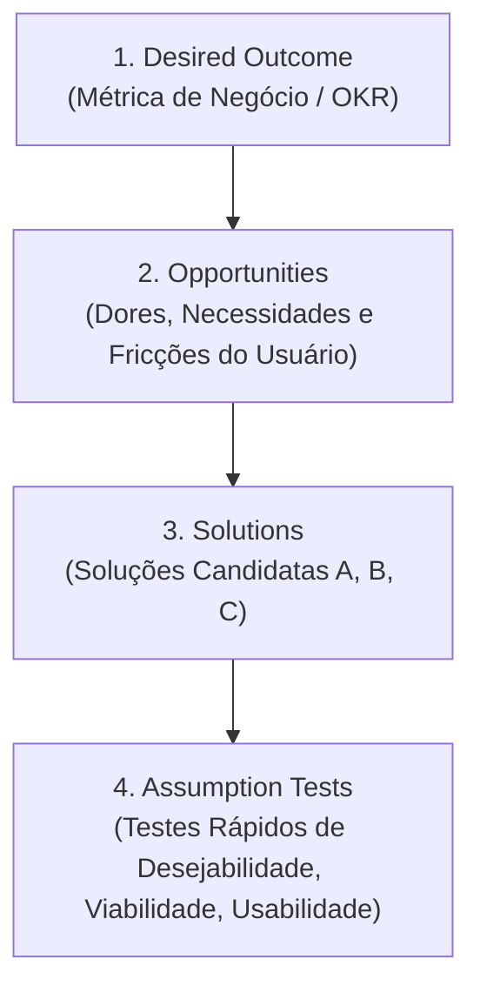

# Matriz de Decisão: Recomendação de Processos de UX Discovery & Opportunity Solution Tree

Um dos papéis primordiais do **UX Strategic Framer Pro** é evitar o desperdício de desenhar e programar soluções em cima de hipóteses falsas.

Esta matriz estabelece critérios objetivos para quando recomendar processos de **UX Discovery**, estruturar a **Opportunity Solution Tree (Teresa Torres)** e quantificar o **Cost of Inaction (COI)** perante stakeholders de negócio.

---

## Matriz de Risco vs. Certeza

| Nível de Certeza | Risco de Negócio / Complexidade | Veredito de Discovery | Ações Recomendadas |
| :--- | :--- | :--- | :--- |
| **Baixo** (Muitas suposições, $\text{Risco} \ge 15$) | **Alto** (Core business / Fluxo crítico) | 🚨 **Discovery Obrigatório** | Entrevistas com Usuários + Análise de Dados + Benchmarking + Assumption Tests |
| **Baixo** (Muitas suposições) | **Baixo** (Funcionalidade isolada / Risco contido) | ⚠️ **Discovery Rápido (Lean)** | Desk Research + Análise Heurística + Teste de Conceito Rápido |
| **Alto** (Dados e telemetria claros) | **Alto** (Redesenho de fluxo crítico) | 🔍 **Discovery Focado** | Análise de Funil (PostHog) + Teste de Usabilidade de Baseline |
| **Alto** (Problema já auditado, $\text{Risco} < 15$) | **Baixo** (Ajuste operacional de UI / Tokens) | 🟢 **Apto para Prototipação** | Ir direto para Wireflow (`02-information-architecture`) & Tokens (`03-design-tokens`) |

---

## 🌳 Framework Opportunity Solution Tree (Teresa Torres)

Quando o stakeholder solicita uma solução pronta sem evidências ("Precisamos de um chatbot na home"), o agente reconstrói a conversa usando as 4 camadas da OST:

### Regras de Ouro da OST no Harness:
1. **Oportunidades NÃO são soluções disfarçadas:** *"Falta um filtro avançado"* é uma solução disfarçada. A oportunidade real é *"Não consigo encontrar os boletos vencidos do mês passado rapidamente"*.
2. **Contraste de Soluções:** Para toda oportunidade prioritária, liste pelo menos 2 caminhos de solução antes de travar o escopo.
3. **Teste de Suposição Mais Arriscada (*Leap-of-Faith Assumption*):** Toda hipótese com pontuação $\text{Impacto} \times \text{Probabilidade} \ge 15$ exige um *Assumption Test* explícito.

---

## 💰 Quantificação Executiva do Cost of Inaction (COI)

Para justificar o investimento em Discovery ou Design para o C-Level/PM, calcule o custo de manter o problema sem solução por 90 dias:

- **COI de Conversão:** $\text{Sessões Afetadas/Mês} \times \text{Drop-off Excedente (\%)} \times \text{Ticket Médio} \times 3\text{ meses}$
- **COI Operacional (Suporte):** $\text{Tickets Mensais da Dor} \times \text{Custo Médio de Atendimento} \times 3\text{ meses}$
- **COI de Retrabalho de Engenharia:** $\text{Dias de Dev em Hipótese Falsa} \times \text{Custo Diário da Squad}$

---

## Guia de Métodos de UX Discovery & Justificativas Prontas

### 1. Entrevistas com Usuários (User Interviews)
* **Quando Recomendar:** Quando as motivações emocionais, o modelo mental ou os motivos de abandono dos usuários são desconhecidos ou baseados em "achismos" de stakeholders.
* **Justificativa Executiva:** *"Recomendamos 5 a 8 entrevistas em profundidade porque a equipe ainda não compreende a causa raiz do abandono. Investir semanas em UI sem validar o modelo mental do usuário gera alto risco de retrabalho."*

### 2. Análise Heurística de Usabilidade (Nielsen / Heuristic Evaluation)
* **Quando Recomendar:** Quando o produto já existe em produção e a equipe relata atritos sem saber onde estão os gargalos de interação e conformidade.
* **Justificativa Executiva:** *"Recomendamos uma análise heurística estruturada para mapear quebras de visibilidade de status do sistema, prevenção de erros e consistência antes de propor novas telas."*

### 3. Análise de Dados e Telemetria (Product Analytics / Funil)
* **Quando Recomendar:** Quando há divergência de opiniões sobre onde os usuários estão saindo do fluxo e faltam evidências quantitativas.
* **Justificativa Executiva:** *"Recomendamos uma auditoria de eventos e taxas de conversão no PostHog/Mixpanel para isolar a etapa exata de maior atrito e focar o esforço de design onde trará maior retorno financeiro."*

### 4. Benchmarking Competitivo & Desk Research
* **Quando Recomendar:** Para mercados com padrões e convenções consolidadas (ex.: checkout, fintech, checkout Pix, onboarding SaaS) onde reinventar a roda cria fricção desnecessária.
* **Justificativa Executiva:** *"Recomendamos um benchmarking analítico com 3 referências diretas e 2 indiretas para identificar as melhores convenções de mercado e acelerar o tempo de entrega da solução."*

### 5. Testes de Usabilidade e Assumption Tests com Protótipo Low-Fi
* **Quando Recomendar:** Para novos fluxos conceituais complexos ou mudanças radicais na arquitetura de informação.
* **Justificativa Executiva:** *"Recomendamos testes remotos moderados com 5 usuários usando wireflows antes de construir componentes de alta fidelidade no Figma, mitigando riscos de usabilidade com custo quase nulo."*
