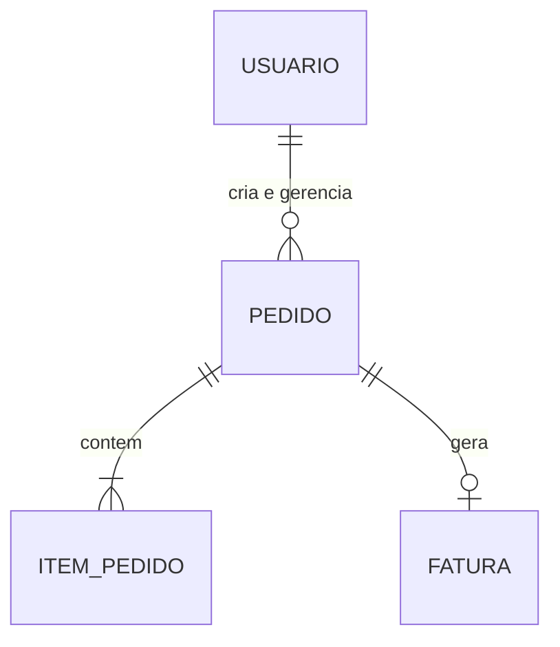
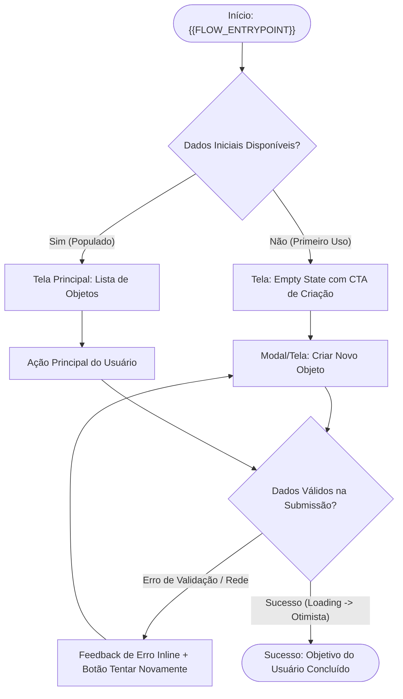
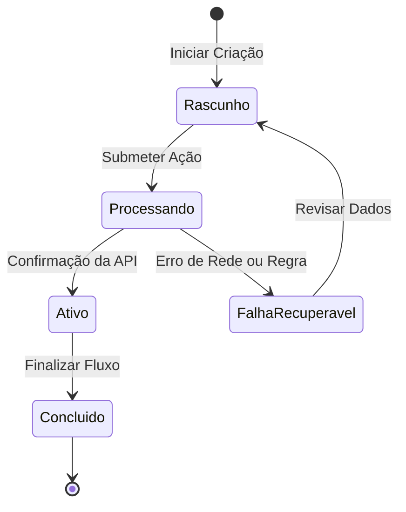

# Especificação de Arquitetura de Informação, OOUX & Wireflows

> **Projeto:** `{{PROJECT_NAME}}` | **Preset:** `{{PRESET_MODE}}` | **Data:** `{{DATE}}`  
> **Skill Emissora:** `02-information-architecture` | **Confidence Score:** `{{CONFIDENCE_SCORE}}`

---

## 1. Ingestão do Framing State (Conexão com Skill 01)

| Parâmetro Estratégico | Valor Herdado de `.harness/memory/framing-state.json` |
| :--- | :--- |
| **Declaração do Problema** | {{PROBLEM_STATEMENT}} |
| **Persona / JTBD Principal** | {{TARGET_USER_JTBD}} |
| **Ponto de Entrada (`flowEntrypoint`)** | {{FLOW_ENTRYPOINT}} |
| **Dentro do Escopo (`inScope`)** | {{IN_SCOPE_SUMMARY}} |
| **Fora do Escopo (`outOfScope`)** | {{OUT_OF_SCOPE_SUMMARY}} |

---

## 2. Matriz OOUX / ORCA (Objects, Relationships, CTAs, Attributes)

| Objeto de Domínio | Relacionamentos (`1:1`, `1:N`, `N:N`) | Calls-to-Action (CTAs por Objeto) | Atributos Core (Identificadores) | Atributos Metadata (Filtros/Status) |
| :--- | :--- | :--- | :--- | :--- |
| **{{OBJECT_1_NAME}}** | {{OBJECT_1_RELATIONS}} | {{OBJECT_1_CTAS}} | {{OBJECT_1_CORE_ATTRS}} | {{OBJECT_1_META_ATTRS}} |
| **{{OBJECT_2_NAME}}** | {{OBJECT_2_RELATIONS}} | {{OBJECT_2_CTAS}} | {{OBJECT_2_CORE_ATTRS}} | {{OBJECT_2_META_ATTRS}} |
| **{{OBJECT_3_NAME}}** | {{OBJECT_3_RELATIONS}} | {{OBJECT_3_CTAS}} | {{OBJECT_3_CORE_ATTRS}} | {{OBJECT_3_META_ATTRS}} |

---

## 3. Modelo Conceitual de Entidades (`erDiagram`)

---

## 4. Wireflow Navegacional Completo (`flowchart TD`)

*Inclui obrigatoriamente o Caminho Feliz (Happy Path), Estados Vazios (Empty), Carregamento (Loading) e Tratamento de Erros (Error Recovery).*

---

## 5. Ciclo de Vida do Objeto Principal (`stateDiagram-v2`)

---

## 6. Matriz dos 4 Estados Obrigatórios por Tela Crítica

| ID do Nó / Tela | 1. Happy Path (Populado) | 2. Empty State (Zero Dados) | 3. Loading / Optimistic State | 4. Error / Edge State (Recuperação) |
| :--- | :--- | :--- | :--- | :--- |
| `MainView` | Lista ordenada pelos atributos Core | Ilustração leve + CTA primário claro | Skeleton de 3 cards preservando layout | Banner de reconexão com cache local |
| `CreateAction` | Formulário enxuto com defaults inteligentes | Campos limpos com placeholders de exemplo | Botão com spinner e trava anti-duplo-clique | Mensagem de erro junto ao campo inválido |

---

## 7. Auditoria de Cognitive Walkthrough (Wharton et al.)

| Etapa do Fluxo | 1. Intenção Alinhada ao JTBD? | 2. CTA Visível? | 3. Rótulo Claro? | 4. Feedback Imediato? | Status |
| :--- | :---: | :---: | :---: | :---: | :---: |
| Entrada $\rightarrow$ Descoberta do Objeto | Sim | Sim | Sim | Sim | Aprovado |
| Disparo do CTA Principal $\rightarrow$ Validação | Sim | Sim | Sim | Sim | Aprovado |
| Recuperação de Erro $\rightarrow$ Conclusão | Sim | Sim | Sim | Sim | Aprovado |

---

## 8. Roteador de Próximos Passos (*Next-Step Router*)

- [ ] **Caminho A (Recomendado — `03-design-tokens`):** Estruturar ou validar a fundação de Design Tokens (W3C DTCG 2025.10, paleta perceptual OKLCH e grid espacial de 4pt/8pt) antes de construir os componentes.
- [ ] **Caminho B (Fast-Track — `04-figma-engineering`):** Avançar diretamente para a engenharia de componentes e telas no Figma/Código caso os tokens já estejam homologados em `.harness/memory/tokens-state.json`.
