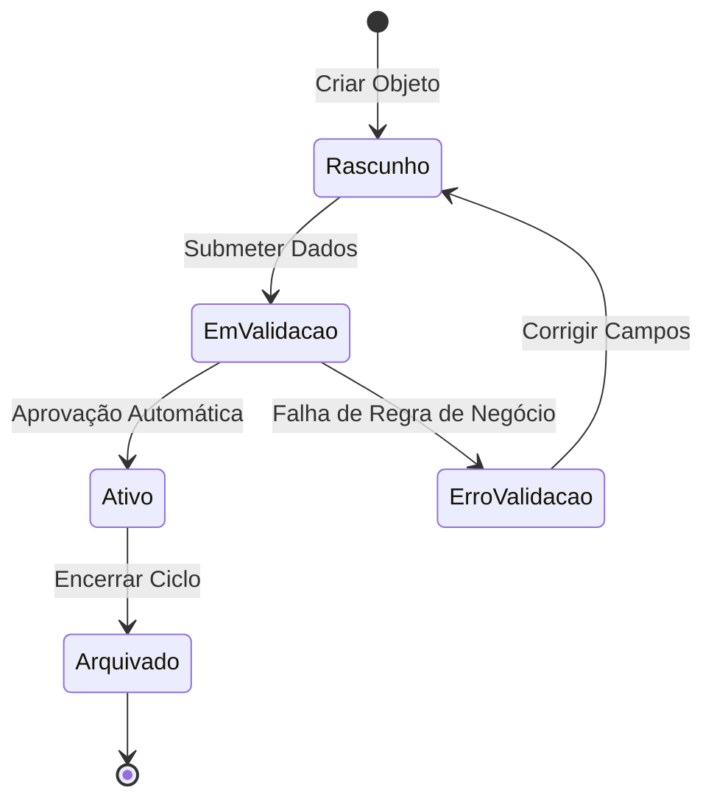

# Guia Definitivo: OOUX, Framework ORCA e Engenharia de Wireflows em Mermaid.js

Este guia estabelece o rigor metodológico e técnico para a **Skill 02: Information Architecture & Wireflows (`02-information-architecture`)**. Ele une **Object-Oriented UX (OOUX)** de Sophia Prater, modelagem de máquinas de estado finitas e **Cognitive Walkthrough** para eliminar ambiguidades estruturais antes de iniciar qualquer trabalho em pixels ou tokens.

---

## 1. Object-Oriented UX (OOUX) & O Processo ORCA

Projetar telas antes de mapear os objetos mentais do domínio é a principal causa de retrabalho em Design Systems e fluxos fragmentados. O **OOUX** alinha o modelo conceitual do usuário ao modelo de dados da engenharia através do framework iterativo **ORCA** (4 rodadas):

### 1.1. Objects (Objetos — Substantivos do Domínio)
Extraia os **substantivos** da declaração de problema e do Job-to-be-Done (JTBD) contidos em `framing-state.json`.
- **Critério de Identificação (SIP):** Todo objeto legítimo possui **S**tructure (atributos), **I**nstances (exemplos concretos) e **P**urpose (valor para o usuário).
- **Exemplos (E-commerce B2B):** `Pedido`, `Fornecedor`, `Fatura`, `Cotação`.
- **Anti-Padrão:** Evite transformar páginas ou verbos em objetos (ex.: "Dashboard", "Configurações" ou "Filtrar" **não** são objetos de domínio).

### 1.2. Relationships (Relacionamentos — Cardinalidade e Aninhamento)
Mapeie como os objetos se conectam usando cardinalidade explícita (`1:1`, `1:N`, `N:N`) antes de decidir a navegação:
- Um `Pedido` possui `1:N` `Itens de Linha` e pertence a `1` `Fornecedor`.
- Uma `Fatura` está vinculada a `1:1` `Pedido`.
- Represente sempre essas relações em um diagrama `erDiagram` (Entity-Relationship) para garantir paridade com a API/banco de dados.

### 1.3. Calls-to-Action (CTAs — Verbos e Permissões por Objeto)
Liste as ações que cada papel de usuário (*Role*) pode disparar diretamente sobre cada objeto:
- **Objeto `Pedido`:** `Criar Rascunho`, `Submeter para Aprovação`, `Cancelar Pedido`, `Exportar PDF`.
- **Objeto `Fatura`:** `Pagar via PIX`, `Contestar Valor`, `Baixar XML`.

### 1.4. Attributes (Atributos — Core Content vs. Metadata)
Decomponha a anatomia de cada objeto para orientar a hierarquia visual futura:
- **Core Content (Conteúdo Identificador):** Título, Nome, Imagem Principal, Valor Total.
- **Metadata (Filtros e Ordenação):** Status (`Pendente`, `Pago`, `Atrasado`), Data de Criação, ID de Rastreio, Autor.

| Objeto (Substantivo) | Instância Exemplo | Relacionamentos (Cardinalidade) | CTAs Primários (Verbos) | Atributos Core vs. Metadata |
| :--- | :--- | :--- | :--- | :--- |
| **Projeto** | "Redesign Checkout v2" | Tem `1:N` Tarefas; Pertence a `1` Workspace | Criar, Arquivar, Compartilhar | **Core:** Nome, Owner. **Meta:** Status, Prazo, Prioridade |
| **Tarefa** | "Validar contraste WCAG" | Pertence a `1` Projeto; Tem `0:N` Comentários | Iniciar, Concluir, Bloquear, Atribuir | **Core:** Título, Descrição. **Meta:** Severidade, Assignee, SLA |

---

## 2. Topologia de Wireflows e Os 4 Estados Obrigatórios de Tela

Um wireflow profissional **nunca** documenta apenas o "Caminho Feliz" (*Happy Path*). Cada nó de visualização ou etapa crítica do fluxo deve prever explicitamente **4 estados de interface**:

1. **Happy Path (Estado Ideal / Populado):** Dados carregados com sucesso, permitindo a ação principal do JTBD.
2. **Empty State (Primeiro Uso / Sem Resultados):** Orientação pedagógica + CTA claro para criar o primeiro objeto ou limpar filtros de busca.
3. **Loading / Optimistic State (Transição Assíncrona):** Skeleton screens, spinners contextualizados ou atualização otimista durante chamadas de rede.
4. **Error / Edge State (Falha de Rede, Validação ou Permissão):** Mensagem acionável explicando a causa e oferecendo rota de recuperação imediata (*Retry*, *Fallback* ou *Edição Inline*).

---

## 3. Regras Estritas de Sintaxe Mermaid.js (Anti-Crash Rendering)

Para garantir que os diagramas renderizem sem erros em qualquer visualizador Markdown (GitHub, Cursor, Antigravity, Notion, Figma Plugins) e passem no validador `scripts/validate-ia-mermaid.ts`, obedeça a estas regras invioláveis:

### 3.1. Tipos de Diagrama Homologados
Utilize exclusivamente:
- `flowchart TD` (Top-Down) ou `flowchart LR` (Left-Right) para wireflows navegacionais e árvores de decisão.
- `stateDiagram-v2` para o ciclo de vida de cada Objeto OOUX (máquinas de estado).
- `erDiagram` para o modelo conceitual de objetos e cardinalidades ORCA.

### 3.2. Proibição Absoluta de HTML e Aspas Obrigatórias
- **NUNCA** utilize tags HTML (` `, ` `, `<b>`, `<i>`, ``) dentro de nós ou arestas do Mermaid.
- **SEMPRE envolva rótulos em aspas duplas** quando contiverem parênteses `()`, colchetes `[]`, chaves `{}`, dois-pontos `:`, barras `/` ou acentuação complexa:
  - **Correto:** `AuthCheck{"Usuário Autenticado (SSO)?"}`
  - **Incorreto (Quebra o Parser):** `AuthCheck{Usuário Autenticado (SSO)?}`

### 3.3. Semântica Visual de Nós no `flowchart`
- `(["Texto"])` — **Estádio / Pílula:** Ponto de entrada (*Trigger*) ou desfecho da jornada (*Goal Reached*).
- `["Texto"]` — **Retângulo:** Tela, Modal, Drawer ou Componente de Visualização.
- `{"Texto?"}` — **Losango:** Nó de decisão condicional do usuário ou validação de sistema (exige no mínimo 2 saídas rotuladas).
- `[["Texto"]]` — **Sub-rotina:** Serviço externo, webhook, autenticação OAuth ou integração assíncrona.

---

## 4. Modelagem de Ciclo de Vida com `stateDiagram-v2`

Todo objeto transacional identificado na Matriz ORCA deve possuir uma máquina de estados finita que governa quais CTAs estão habilitados ou bloqueados em cada momento:

---

## 5. Protocolo de Auditoria: Cognitive Walkthrough (4 Perguntas de Wharton)

Antes de liberar o handoff para a Skill 03 ou Skill 04, percorra cada passo crítico do wireflow respondendo às **4 perguntas canônicas de Cognitive Walkthrough** (Wharton et al.):

1. **Intenção do Usuário (Goal Alignment):** O usuário tentará alcançar o efeito que a interface propõe nesta etapa (conforme seu JTBD)?
2. **Visibilidade da Ação (Discoverability):** O controle ou CTA necessário para avançar está visível e evidente no nó/tela atual?
3. **Compreensão Semântica (Signifier Clarity):** O usuário reconhecerá que aquele controle específico executa a ação desejada (o rótulo usa o vocabulário mental do usuário)?
4. **Feedback de Progresso (System Status):** Após executar a ação, o usuário recebe feedback imediato e inequívoco de que avançou rumo ao seu objetivo (ou de como corrigir um erro)?

> **Critério de Aprovação (Gate):** Um fluxo só recebe `cognitive_walkthrough_passed: true` quando todas as etapas críticas possuem caminhos de recuperação de erro e zero becos sem saída (*dead-ends*).
