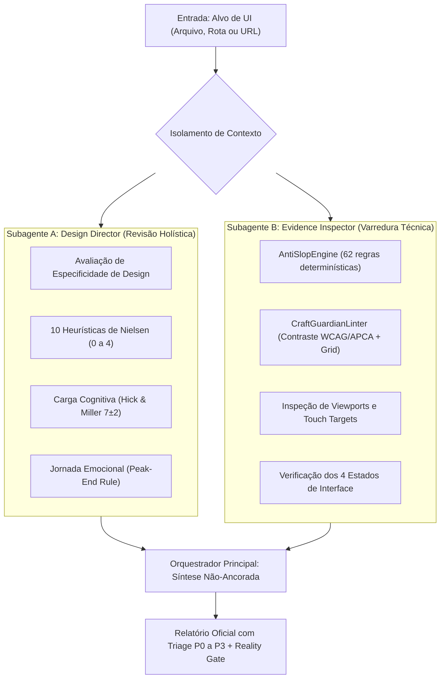

# Protocolo Dual-Agent: Crítica e Auditoria de Interface Sem Viés de Ancoragem

> O maior risco em auditorias conduzidas por agentes de IA é o **viés de ancoragem** (*anchoring bias*): quando o modelo recebe um log de erros de linters ou analisadores de código antes de avaliar o design, ele tende a papagaiar os mesmos erros técnicos e ignora a visão holística de usabilidade, hierarquia, carga cognitiva e jornada emocional.
> Este protocolo estipula o isolamento rigoroso entre a revisão de direção de design e a coleta de evidências determinísticas.

---

## 1. Topologia da Execução

---

## 2. Responsabilidades do Subagente A (Design Review)
O Subagente A **NÃO DEVE** receber o relatório do linter determinístico. Ele atua como um Design Director sênior:

1. **Especificidade de Design:**
   - A composição, a paleta e os componentes são específicos para a realidade deste produto e seus usuários, ou qualquer produto genérico poderia usar a mesma tela sem modificações?
2. **10 Heurísticas de Nielsen (Escala 0 a 4):**
   - Pontue cada heurística de 0 (grave/violada) a 4 (excelente/exemplar):
     1. Visibilidade do status do sistema
     2. Correspondência entre o sistema e o mundo real
     3. Controle e liberdade do usuário (botão desfazer, cancelar)
     4. Consistência e padrões
     5. Prevenção de erros
     6. Reconhecimento em vez de recordação
     7. Flexibilidade e eficiência de uso (atalhos, busca)
     8. Estética e design minimalista (remover ruído)
     9. Auxílio aos usuários no reconhecimento e recuperação de erros
     10. Ajuda e documentação
3. **Carga Cognitiva:**
   - Lei de Hick: existem pontos de decisão com mais de 4 opções sem agrupamento lógico?
   - Agrupamento de Miller (7±2): chunks visuais claros e escaneáveis.
4. **Jornada Emocional & Peak-End Rule:**
   - Como o usuário se sente no momento de pico de esforço (ex.: preenchimento de formulário ou checkout)?
   - Há alívio e clareza no encerramento (Peak-End)?

---

## 3. Responsabilidades do Subagente B (Evidence Inspector)
O Subagente B executa os testes determinísticos de forma objetiva:

1. Executa o `AntiSlopEngine` sobre os arquivos-fonte da tela.
2. Executa o `CraftGuardianLinter` calculando numericamente o contraste WCAG 2.2 AA e APCA $L_c$.
3. Valida a grade espacial de 8px e alvos de toque ($\ge 44\times44\text{px}$ em mobile / $\ge 24\times24\text{px}$ em desktop).
4. Verifica a cobertura dos 4 estados obrigatórios: *default*, *loading*, *empty*, *error*.

---

## 4. Síntese pelo Agente Orquestrador
O orquestrador recebe ambos os outputs e constrói o relatório final hierarquizado:
- **P0 (Bloqueante):** Erros que impedem a conclusão da tarefa do usuário ou quebram o código.
- **P1 (Major):** Violações de acessibilidade WCAG AA, falhas de contraste ou regras severas do AntiSlopEngine.
- **P2 (Minor):** Pequenas incoerências visuais, espaçamentos desalinhados ou leading comprimido.
- **P3 (Polimento):** Micro-refinamentos de estilo, classes auxiliares e superfícies nativas do navegador.
