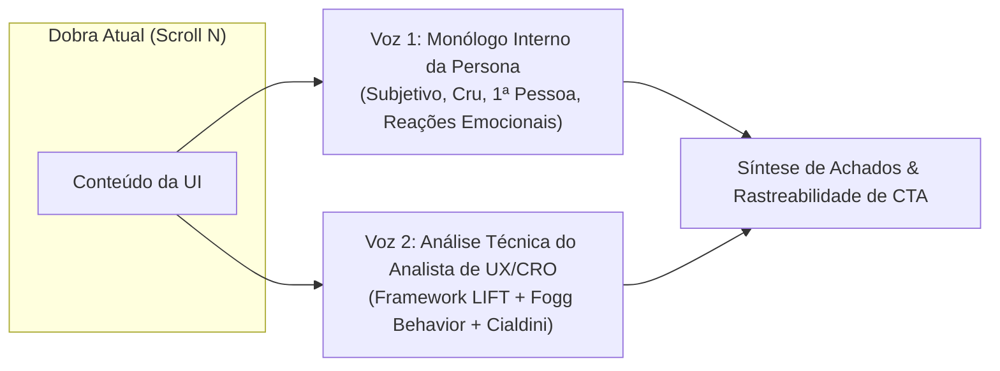

# Framework de Walkthrough Cognitivo e Avaliação em Duas Vozes

Este documento orienta a condução da análise psicológica e comportamental scroll a scroll do **Persona Walkthrough** (Skill 09).

---

## 1. A Metodologia das Duas Vozes (Dual-Perspective Analysis)

Para cada dobra (*viewport/scroll*), o avaliador deve separar estritamente a reação intuitiva e emocional do usuário da dissecação técnica do especialista de UX/CRO.



### Voz 1: O Monólogo Interno da Persona (Raw Stream of Consciousness)
- **Natureza:** Redigido em primeira pessoa ("Eu", "minha cabeça").
- **Tom e Linguagem:** Cru, impaciente, enviesado, humano. Espelha exatamente o arquétipo psicológico, suas preocupações financeiras, cansaço, desconfiança e pressa.
- **Perguntas Típicas que a Persona Verbaliza:**
  - *"Cadê o preço dessa joça? Por que tão escondendo?"*
  - *"Texto demais em bloco longo... não vou ler isso nem ferrando."*
  - *"Quem é essa empresa? Nunca ouvi falar, será que não é golpe?"*
  - *"Esse botão tá pedindo cartão de crédito? Nem pensar."*
  - *"Ah, finalmente! Esse gráfico é exatamente o relatório que meu chefe me pediu."*

### Voz 2: A Análise Estruturada do Especialista de UX / CRO
- **Natureza:** Técnica, diagnóstica, prescritiva e objetiva.
- **Modelos Teóricos Aplicados:**
  1. Framework LIFT (WiderFunnel)
  2. Modelo Comportamental de Fogg (B = MAP)
  3. Princípios de Influência de Cialdini

---

## 2. Framework LIFT (WiderFunnel)

O modelo LIFT avalia 6 dimensões de conversão e experiência:

```text
       [ Value Proposition ]  <-- Veículo Central
            /          \
   (Impulso)            (Inibição)
   - Relevance          - Anxiety
   - Clarity            - Distraction
            \          /
         [ Urgency ]          <-- Catalisador
```

1. **Value Proposition (Proposta de Valor):** O custo-benefício percebido pela persona nesta dobra. É o equilíbrio entre os custos (tempo, dinheiro, esforço) e os benefícios prometidos.
2. **Relevance (Relevância):** O conteúdo desta dobra responde diretamente à expectativa da persona gerada pelo anúncio, busca no Google ou etapa anterior?
3. **Clarity (Clareza):** A hierarquia visual, tipografia, contraste e redação (copy) comunicam a mensagem instantaneamente, sem ambiguidades?
4. **Urgency (Urgência):** Há incentivos éticos para agir agora (ex: prazo real de encerramento, bônus temporário) ou urgência interna decorrente do próprio Job-to-be-Done da persona?
5. **Anxiety (Ansiedade):** Quais elementos desta dobra geram medo, incerteza ou dúvida (*FUD*)? (Ex: ausência de certificado de segurança, políticas de cancelamento obscuras, formulários que pedem dados sensíveis precocemente).
6. **Distraction (Distração):** Há elementos visuais fora de contexto (menus inflados, múltiplos links secundários, animações desnecessárias) desviando a atenção do objetivo principal?

---

## 3. Modelo Comportamental de Fogg (Fogg Behavior Model — B = MAP)

Para que a persona execute a ação esperada nesta dobra, três fatores devem convergir simultaneamente:

$$\text{Comportamento (B)} = \text{Motivação (M)} \times \text{Habilidade (A)} \times \text{Prompt / Gatilho (P)}$$

- **Motivação (Motivation):**
  - Alta: A persona acabou de ver uma demonstração que resolve sua maior dor.
  - Baixa: A persona foi exposta a jargões que não entende e está cansada.
- **Habilidade / Simplicidade (Ability):**
  - A ação solicitada é simples? Fatores de simplicidade de Fogg: tempo gasto, dinheiro envolvido, esforço físico (rolagem/digitação), esforço mental (cálculo/decisão), desvio de rotina.
- **Prompt / Gatilho (Prompt):**
  - O gatilho para a ação está presente e visível no momento exato em que a motivação está no ápice? (Se houver motivação e habilidade, mas faltar o prompt, a conversão não ocorre).

---

## 4. Princípios de Persuasão e Influência de Cialdini

Verifique se a dobra emprega (ou deixa de empregar quando necessário) as 6 alavancas éticas:
1. **Prova Social (Social Proof):** Depoimentos reais com nome, cargo e foto; números auditados ("Mais de 12.000 profissionais usam"); notas em plataformas públicas (Trustpilot, G2, ReclameAqui).
2. **Autoridade (Authority):** Certificações de segurança (SOC2, LGPD, ISO), selos de órgãos reguladores, menções na imprensa técnica especializada.
3. **Escassez (Scarcity):** Disponibilidade limitada de vagas ou lotes de teste (deve ser genuína, nunca falsa urgência com contadores artificiais).
4. **Reciprocidade (Reciprocity):** Entrega de valor gratuito preliminar (calculadora interativa, template aberto, diagnóstico gratuito) antes de exigir dados.
5. **Compromisso e Coerência (Commitment & Consistency):** Início por micro-ações de baixo atrito antes de pedir compromissos maiores.
6. **Afeição / Identificação (Liking):** Tom de voz humanizado e histórias que geram empatia imediata com o problema da persona.

---

## 5. Rastreabilidade de CTA por Dobra (CTA Reachability)

A cada scroll, deve-se registrar a disponibilidade do Primary CTA:

- **Métrica de Esforço de Ação (`effortToAct`):**
  - `immediate`: CTA visível na tela atual sem rolagem adicional (botão fixo/sticky ou componente nativo da dobra).
  - `low_scroll`: CTA acessível com rolagem curta ($\le 300\text{px}$).
  - `high_scroll`: Exige rolagem substancial ($> 600\text{px}$) para reencontrar o botão de ação.
  - `lost`: Ausência total de CTA nesta seção; usuário precisa rolar de volta para o topo ou procurar desesperadamente.
- **Zonas Mortas (Dead Zones):** Dobras onde a persona atinge pico de interesse (ex: tabela comparativa de preços), mas não há nenhum botão para agir imediatamente naquela altura da página.

---

## 6. Aviso Obrigatório de Hipótese Qualitativa (DISCLAIMER)

Toda entrega analítica desta skill deve reforçar explicitamente o limite metodológico:

> [!NOTE]
> **Aviso de Limite Metodológico:** Este relatório é uma simulação cognitiva qualitativa baseada em arquétipos comportamentais, não constituindo evidência estatística. Seus achados representam fortes hipóteses a serem validadas com testes de usabilidade reais ou telemetria pós-lançamento.
