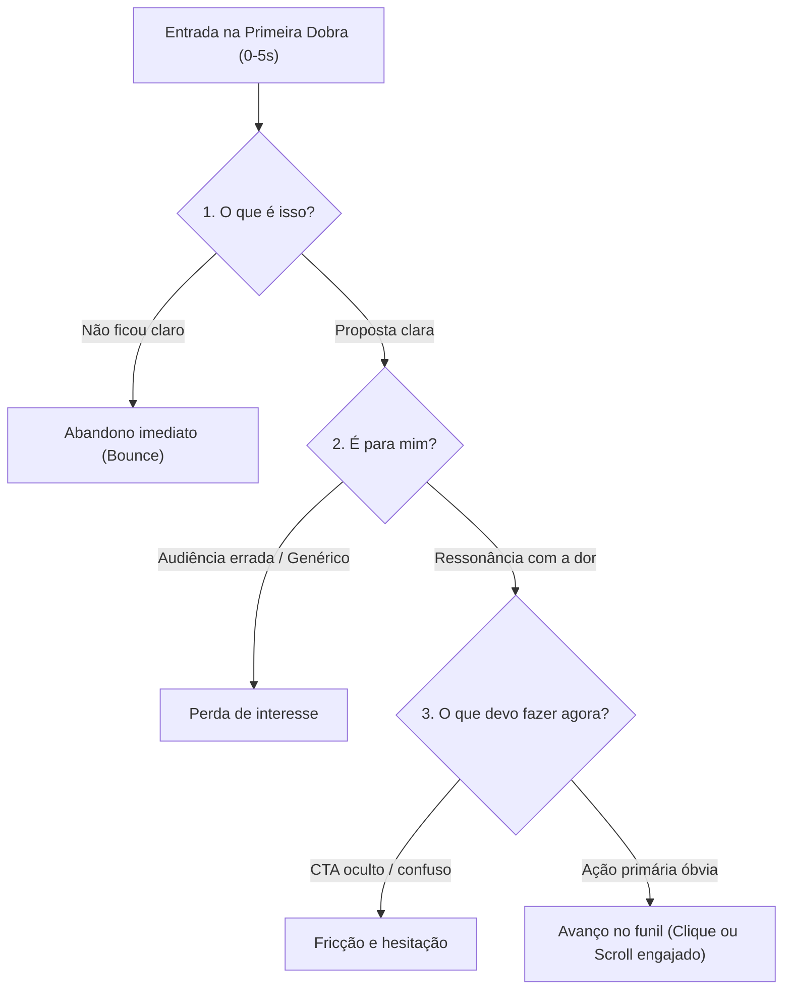

# Guia Metodológico: O Teste dos 5 Segundos (Five-Second Test)

Este documento normatiza a aplicação da **Fase 1 Obrigatória** do Persona Walkthrough. O objetivo é simular o processamento pré-atencional e cognitivo imediato que ocorre nos primeiros 5 segundos de exposição à primeira dobra (*above the fold*) de uma página ou fluxo.

---

## 1. Fundamentos Científicos do Processamento Imediato

Estudos seminais de usabilidade e psicologia cognitiva estabelecem que:
- **Primeira impressão estética (50 milissegundos):** Pesquisas de Lindgaard et al. (2006) comprovam que o cérebro humano julga a confiabilidade visual de uma página em 1/20 de segundo.
- **Janela de decisão de permanência (10 a 15 segundos):** Segundo o Nielsen Norman Group (NN/g), a maioria dos usuários decide se fica ou abandona a página em menos de 15 segundos. Se a proposta central não for assimilada nos primeiros 5 segundos, a taxa de rejeição (*bounce rate*) dispara.
- **Economia de atenção & Carga Cognitiva:** Usuários não leem páginas na íntegra; eles escaneiam buscando pistas que validem seu objetivo imediato (*information scent*).

---

## 2. As Três Perguntas Sagradas da Primeira Dobra

Ao aterrissar na primeira dobra, o avaliador deve incorporar a persona e responder estritamente a três perguntas cruciais:

### Pergunta 1: O que é isso? (What is this?)
- **Foco:** Proposta de valor central e categoria do produto/serviço.
- **Critérios de Avaliação:**
  - O H1 (headline) descreve a solução sem metáforas abstratas ou jargões ocos (ex: "Aceleramos o futuro das sinergias corporativas" = FALHA; "Software de conciliação bancária automática para PMEs" = APROVADO).
  - A sub-headline clarifica como funciona em uma frase legível.
  - O elemento visual âncora (screenshot da interface real, vídeo curto de demonstração ou fotografia contextual) comprova a entrega, em vez de ilustrações 3D genéricas ou fotos de banco de imagem não relacionadas.
- **Pontuação (1 a 5):**
  - `1`: Incompreensível; usuário não consegue adivinhar o que a empresa faz.
  - `3`: Entende a categoria geral, mas não fica claro o diferencial.
  - `5`: Proposta cristalina em menos de 3 segundos de leitura escaneada.

### Pergunta 2: É para mim? (Is it for me?)
- **Foco:** Ressonância de público-alvo e contexto específico da persona.
- **Critérios de Avaliação:**
  - A página fala diretamente ao segmento da persona (ex: "Para freelancers", "Para times de engenharia", "Para clínicas médicas").
  - A dor prioritária da persona é mencionada ou espelhada logo no topo.
  - Os elementos visuais refletem o nível de sofisticação e o vocabulário esperado pelo arquétipo.
- **Pontuação (1 a 5):**
  - `1`: Parece voltado para um público completamente diferente ou é genérico demais.
  - `3`: Pode ser aplicável, mas exige esforço para descobrir compatibilidade.
  - `5`: Sensação imediata de acolhimento e pertinência ("Eles criaram isso exatamente pro meu problema").

### Pergunta 3: O que devo fazer agora? (What should I do next?)
- **Foco:** Hierarquia e clareza da chamada para ação primária (Primary CTA).
- **Critérios de Avaliação:**
  - Há um único botão de ação primária destacado com contraste cromático expressivo em relação ao fundo.
  - O microcopy do botão usa verbos no infinitivo ou primeira pessoa expressando valor real (ex: "Começar teste grátis de 14 dias", "Calcular minha economia", "Ver preços"), evitando rótulos vagos ("Enviar", "Clique aqui", "Saiba mais").
  - O custo percebido do próximo passo é baixo (ex: indicação explícita de "Sem cartão de crédito", "Instalação em 2 minutos").
- **Pontuação (1 a 5):**
  - `1`: Nenhum botão visível acima da dobra ou mais de 3 ações concorrendo com mesmo peso.
  - `3`: Botão existe, mas rótulo é ambíguo ou contraste é baixo.
  - `5`: Próximo passo saliente, inequívoco e convidativo ao clique imediato.

---

## 3. Protocolo de Pontuação e Veredito

| Métrica | Faixa de Pontos | Significado Operacional |
| :--- | :--- | :--- |
| **P1: O que é isso?** | 1 a 5 | Clareza da Proposta de Valor |
| **P2: É para mim?** | 1 a 5 | Ressonância e Fit com a Persona |
| **P3: O que fazer agora?** | 1 a 5 | Saliência e Acessibilidade do CTA |
| **Pontuação Total** | **3 a 15** | Soma simples das 3 perguntas |

### Regra de Veredito:
- **Aprovado no Teste dos 5 Segundos (`passed: true`):**
  - Pontuação Total $\ge 12$ E nenhuma pergunta individual com nota $< 3$.
- **Reprovado no Teste dos 5 Segundos (`passed: false`):**
  - Pontuação Total $< 12$ OU qualquer pergunta individual com nota $< 3$.
  - Gera automaticamente um finding de severidade `critical` ou `major` para a dobra 1.

---

## 4. Anti-Patterns Críticos na Primeira Dobra

1. **Headline Filosófica / Vazia:** Ex: "Revolucionando experiências para transformar o amanhã". A persona não sabe se é um banco, uma consultoria ou uma agência de marketing.
2. **Ausência de Produto Real (Visual Slop):** Ilustrações corporativas genéricas ("flat corporate illustration") ou renders 3D de esferas e ondas sem mostrar a interface real.
3. **Múltiplos CTAs Primários em Guerra:** Dois botões lado a lado com cores idênticas ("Comprar agora" e "Agendar demonstração técnica").
4. **Formulário de Cadastro Agressivo Imediato:** Pedir 8 campos na dobra 1 antes de explicar o benefício real do produto.
5. **Carrossel Automático (Sliders):** Banners rotativos que trocam de mensagem a cada 3 segundos, impedindo a persona de ler a proposta no seu próprio ritmo.
